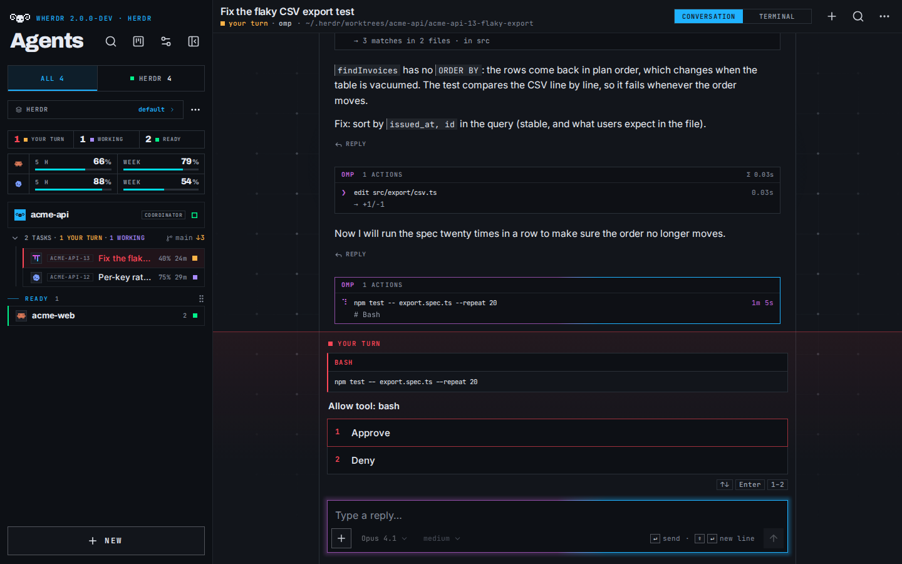
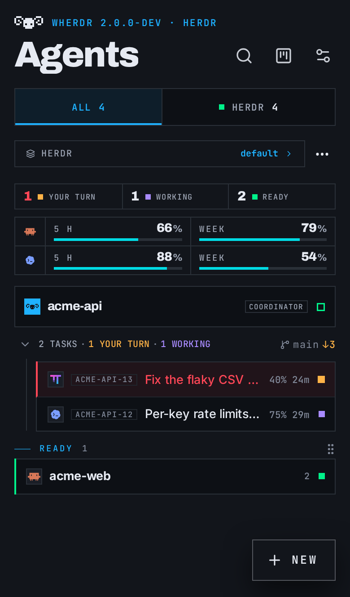
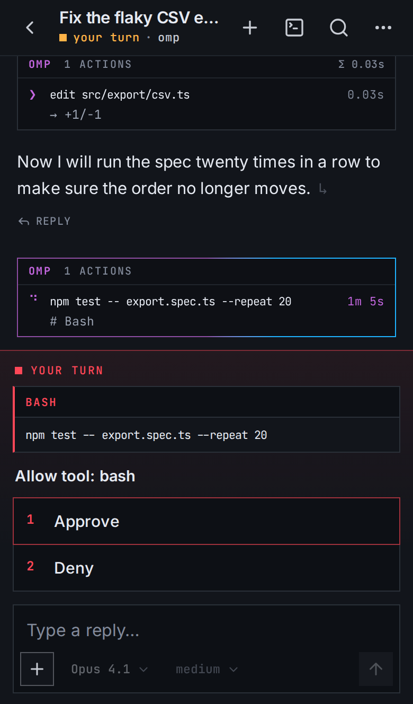

<p align="center">
  
</p>

<h1 align="center">wherdr</h1>

<p align="center"><b>Start your <a href="https://herdr.dev">Herdr</a> agents on your computer.
Follow their work and answer from your phone.</b></p>

<p align="center">Add it to your home screen like an app — no App Store needed.</p>

<p align="center">
  <a href="assets/wherdr-launch.mp4"></a>
</p>
<p align="center"><sub>Start on PC. Stay in control from your phone. Real app, demo data. <a href="assets/wherdr-launch.mp4">Watch the 15-second video</a>.</sub></p>

<p align="center"><a href="https://wherdr.dev"><b>wherdr.dev</b></a> · <a href="#ask-your-ai-agent">Ask your AI agent</a></p>

<p align="center"><a href="https://wherdr.dev/demo/"><b>Try it in your browser — no install</b></a>: the real app on scripted agents, nothing runs.</p>

<p align="center"><a href="https://github.com/afloury/wherdr/actions/workflows/ci.yml"></a></p>

## Quick start

### Ask your AI agent

**Recommended.** Paste this into Claude Code, Codex or any coding agent: it installs and sets up wherdr for you.

```text
Read https://wherdr.dev/agent.md and help me set up wherdr. Check what is already installed first, and ask me before installing anything.
```

It follows [our setup guide for agents](https://wherdr.dev/agent.md): checks what you already have,
asks before installing anything, sets up your phone over Tailscale, never exposes wherdr to the Internet.

### Or run the installer yourself

On the computer that runs [Herdr](https://herdr.dev) (≥ 0.9.1), macOS or Linux:

```sh
curl -fsSL https://wherdr.dev/install | sh
```

It installs the wherdr [Herdr plugin](#install-as-a-herdr-plugin) with the verified package of the
GitHub release, runs wherdr natively as your user on `http://localhost:7683`, starts it at every
boot (a `systemd --user` service with lingering on Linux, a LaunchAgent on macOS) and opens its
setup guide in your browser; then **prefix+i** in Herdr opens the wherdr panel. Without Herdr, it
says where to get it; without Node.js 22, it offers to install it (Homebrew, or the official
build in `~/wherdr/node`, no sudo). On a server without a screen (or over SSH), it prints the
address and the phone steps instead. See [The one command](#the-one-command).

**Native is the setup to use**: only a wherdr running on the host can act on the
[herdr-projects Board](#works-great-with-herdr-projects) (Coordinator, reply, start, stop,
approve). Other ways, after it: `herdr plugin install afloury/wherdr` (the same plugin, without
the checks), and [the `wherdr` command](#the-wherdr-command) from npm or Homebrew (npm can hold a
new release for up to two days; the installer gets it from GitHub at once).
[Docker](#docker-on-request) stays possible on request, with a read-only Board.

At first launch, wherdr opens a **setup guide**: the Herdr agents it found, your phone
(Tailscale), then the passkey lock and notifications. Skip it any time; finishing or skipping is
saved on the server (`data/onboarding.json`), so your other devices do not show it again. Reopen
it from Settings › About › **Setup guide**. On a phone that already opens wherdr through its
tailnet address, the phone step becomes Add to Home Screen.

**Passkeys are tied to the address they are created on.** Once wherdr's tailnet address is
published and answers, the guide opened on `localhost` shows **Continue on
<machine>.<tailnet>.ts.net**, which reopens it at the same step on that address, and its Security
step (like Settings › Security) sends the passkey lock there. Nothing redirects on its own:
`localhost` stays valid on the computer. The installer, the Herdr plugin and `wherdr open` open
that address too when it is already published.

wherdr is a small self-hosted web app that talks to the Herdr server on your machine. **On a
computer**, it can replace the Herdr terminal client day to day: your spaces, tabs and split panes
side by side, live conversations and real terminals, drag-and-drop layout, keyboard shortcuts
and a task board for herdr-projects. **On a phone**, installed as a PWA, it is the companion
that follows your agents when you are away: push notifications when an agent finishes or needs
you, one-tap answers, quick replies and offline reading.

It lists your agents live — Claude Code, Codex and the other agents Herdr recognizes — and works
on the same Herdr session `herdr` attaches to: nothing is copied, nothing runs in the cloud. Use
it on `localhost`, or from your other devices over Tailscale.

> [!WARNING]
> **wherdr is a remote shell on your machine.** Anyone who can reach it can start agents and
> run commands as your user. **Never expose it on the public Internet** (no port forwarding, no
> public reverse proxy, no tunnel). Use it on `localhost`, or from your other devices through a
> private network such as [Tailscale](https://tailscale.com). wherdr refuses any other network
> by itself; the passkey lock is an optional extra. See [Security](#security).

<p align="center">
  
</p>
<p align="center"><sub>On a computer</sub></p>
<br>
<p align="center">
  
  &nbsp;&nbsp;&nbsp;&nbsp;
  
</p>
<p align="center"><sub>On a phone: the same agents, the same session.</sub></p>

*Unofficial project. Not affiliated with or endorsed by Herdr, Anthropic or OpenAI. Claude,
Claude Code, Codex and other product names are trademarks of their respective owners.*

## Why wherdr

- **Herdr's splits, live.** A tab with several panes is drawn in Herdr's real layout, every pane
  live; drag a pane to move it or a divider to resize, and the change goes to Herdr itself.
- **Private by default, passkey lock optional.** wherdr answers only its own computer and your
  tailnet. Add a passkey if you like: Face ID, Touch ID, Windows Hello or Android unlock the app,
  and nothing about your agents is served to a locked session.
- **The agent's diff.** Git status and diff of each agent's working folder, one click away from
  its conversation.
- **The herdr-projects board.** Every machine's herdr-projects tasks in the board's own groups,
  with replies to their agents, approval of finished work and a box for the Coordinator.
- **Keyboard and global search.** One shortcut searches every agent and conversation; next
  agent, new tab, pane swaps and `1`–`9` answers never need the mouse.
- **Real time, and private.** The real terminal over a WebSocket, a push when an agent needs
  you, and your phone through Tailscale: nothing is on the Internet.

Details in [Features](#features) and [Security](#security).

## Contents

- [Quick start](#quick-start)
- [Why wherdr](#why-wherdr)
- [Features](#features)
- [How it works](#how-it-works)
- [Requirements](#requirements)
- [Installation](#installation): [ask your AI agent](#ask-your-ai-agent-1) ·
  [or run the installer yourself](#the-one-command) ·
  [which setup?](#which-setup) ·
  [always-on server + Tailscale](#recommended-always-on-server--tailscale) ·
  [other private networks](#other-private-networks) ·
  [as a Herdr plugin](#install-as-a-herdr-plugin) ·
  [the `wherdr` command (npm, Homebrew)](#the-wherdr-command) ·
  [from source](#from-source) ·
  [Docker, on request](#docker-on-request) ·
  [moving from Docker to the native service](#moving-from-docker-to-the-native-service)
- [Updating](#updating)
- [Install it as an app](#install-it-as-an-app)
- [Configuration](#configuration)
- [Several machines (SSH)](#several-machines-ssh)
- [Claude and Codex quotas](#claude-and-codex-quotas)
- [Notifications](#notifications)
- [Works great with herdr-projects](#works-great-with-herdr-projects)
- [Herdr plugins](#herdr-plugins)
- [Security](#security)
- [Troubleshooting](#troubleshooting)
- [Contributing](#contributing) · [License](#license)

## Features

### Everywhere

- **Live agent list**, one line per Herdr space, grouped by state (your turn, working, ready).
  The list is compact by default: agent, title, project badge and state. When an agent asks for
  permission or asks a question, its card opens on the question and its options: **answer in one
  tap** without opening it; the card is one line again once answered. Turn off Settings ›
  Appearance › Home screen › **Compact list** for detailed cards, with the folder, the model and
  a preview of each agent's last answer.
  With [herdr-projects](#works-great-with-herdr-projects), the board's spaces follow Herdr's sidebar:
  the Coordinators on top, then each repo's space (branch, `↓` commits behind its upstream) with
  its project coordinator as the group's lead, right under it (the coordinator's icon, its state
  and last message), then its tasks (key, title, progress, time on it, the board's current line);
  closing a space that holds task agents names the tasks it stops.
- **Conversation view**: the agent's real transcript (Claude Code, Codex and omp), rendered as
  Markdown, with grouped tool calls, images (full-screen viewer with pinch / wheel zoom and pan), timestamps, search and infinite scroll back to the
  first message. Reading a conversation never touches the terminal, so it never resizes a pane.
  A command the agent proposes (shell code block, or inline `! command`) can be copied without
  its prompt, or run in the agent's shell mode (`!`, Claude Code, Codex and omp) after you
  confirm the full command.
- **Terminal view**: the real terminal (xterm.js, WebGL or DOM renderer) with take-over. Opening
  it resizes the real pane to your screen (or its cell in a split); closing it gives the pane the size it had before
  (after 30 seconds when the connection just dropped, e.g. a locked phone), unless a Herdr
  client attached meanwhile laid it out its own way. On a
  computer, drag over the text on screen to select it: releasing the button copies it, as do
  `⌘C` / `Ctrl+Shift+C`. The history is browsed with the wheel, not by dragging past the edge.
  Links (OSC 8 hyperlinks and plain `http(s)://` URLs, even wrapped over several rows) open in a
  new tab with `⌘`+click / `Ctrl`+click, or a tap on a phone; only http and https open. A long
  line wrapped by the width is copied in one piece, without the breaks between its rows. An image
  pasted with `⌘V` (Mac), here or in a side-by-side terminal, goes to the agent's machine and its
  path is pasted, which omp and Claude Code attach as an image, as in the conversation.
- **Interactive agent screens**: in a conversation, an uncertain menu or panel opens the
  pane's real terminal in a modal window, with arrows, Enter, Escape, Tab, digits and y/n.
  The rest of the app waits behind a scrim (the window fills the screen on a phone); in a
  split, only the cell in use opens it. It closes after the agent's message field returns.
  Close it yourself at any time with its button or a click on the scrim: that releases the
  terminal without pressing Escape, which goes to the agent, and the same interaction stays
  closed until you reopen it. Existing native questions, approvals, menus, waiting screens and
  Claude settings cards keep their controls. The window is a fallback after those
  recognizers, with two explicit exceptions: Codex's two-column `/usage` menu and
  its Agent Command Center. The slash menu still lists and sends commands. On a phone, the window
  temporarily fits the real pane to its width and restores its size on release, using
  the same lease as Terminal view; it does not shrink 120 columns into unreadable text.
  A pane already shown in Terminal keeps its existing live view. Try `/usage` on the
  Codex agent in the browser demo (scripted, no account data).
  In the compact list, native questions keep their preview and one-tap answers.
  Unrecognized blocking screens offer an **Open interactive terminal** button.
- **Composer**: send messages while the agent works (queued, cancellable: the agent's own
  queue when it takes them, else held by wherdr and sent when the turn ends; never left
  half-typed in its field, and “Not sent” clears once the message shows in its transcript), attach or paste
  photos and the files the agent can read (Claude Code: PDFs, notebooks, text and code of any
  extension; Codex: notebooks, text and code), run slash commands (`/compact`, `/clear`, `/context`, `/usage`…) and see the output
  of local commands. Stop button while the agent works. A long pasted text (log, output) becomes
  a "Pasted text · N lines" card, sent to the agent as it is and shown the same way in the
  conversation, where it opens in full with Copy; long typed messages fold with Show more.
- **Codex updates and limits**: in a Codex conversation, a new Codex version shows above the
  field with an **Update** button (runs Codex's official update command on that machine, after
  confirmation), then **Restart to update** on the same conversation. When wherdr cannot run it
  (Docker, read-only home), Update exits Codex, runs the command in the agent's own terminal and
  resumes the same conversation (only while Codex is idle). Codex's own weekly-limit warning
  (its footer gauge, or its startup heads-up) is repeated above the field, with its values, while
  Codex shows it.
- **After Codex updates itself and exits**: a **Your turn** card offers **Restart Codex**
  for a new conversation, with the original launch arguments. For an existing conversation,
  choose **Resume conversation** (its exact session, with the original options) or **Start
  fresh**. If wherdr cannot identify the session, Resume opens Codex's picker rather than
  choosing another pane's latest conversation. The usual attention notification applies.
  Nothing restarts automatically: the pane must still show the same empty shell prompt,
  with the shell in the foreground. Unrecognized shell prompts require a manual restart
  in the terminal. wherdr must have observed Codex before it exited.
  **Dismiss** puts the card away for good: the pane is a plain shell again, to use as you like.
  Messages sent meanwhile wait in the queue until the agent returns; if it does not (Dismiss, or
  a Codex that simply left), their text goes back into the pane's message field. Continuation
  prompts (unfinished quotes or heredocs) refuse a restart too. If the final
  transcript read fails, both conversation choices remain available; a session
  contradicted by a guessed match is resumed through Codex's picker.
- **Model and effort pickers** for Claude Code, Codex and omp (omp: its
  "Switch Model" selector, `/switch` or `/model`, and its thinking level, changed with its own
  ⇧⇥ cycle). Changes apply **to the current session only**; wherdr never changes your default
  model.
- **New agent**: pick an installed agent (or a plain terminal), a folder, optionally a separate
  Git **worktree** and branch, resume the last conversation, and queue a first message.
- **Changes view**: Git status and diff of an agent's working folder; worktree management.
  Review the diff like a pull request: comment on one line or on a **block of lines**. The code
  itself is plain text — a click on it does nothing, so it can be selected and copied.
  - **Mouse**: a **+** appears in the gutter of the hovered line; click it to comment that line,
    or press it and drag over other lines to comment the block. With an editor open, Shift+click
    another line to change its block.
  - **Touch**: tap a line number to choose the line, tap another line to extend the block, then
    **Comment** in the bar pinned at the bottom. Nothing is written by the first tap.
  - **Keyboard**: one tab stop per file; arrow keys move between lines, Shift+arrows choose a
    block, Enter opens the editor. In the editor, ⌘/Ctrl+Enter saves and Escape cancels (a second
    Escape if text would be lost); the window stays open.

  A block stays within one hunk (the other hunks dim while it is chosen) and may mix deleted and
  new lines. Each comment is a thread under the last line of its block, headed by its lines
  ("Lines 12–18"), with **Edit** and a two-step **Delete**; the lines it covers are marked in
  the gutter. Comments, including the text of an editor left open, are saved on this device for
  that agent, across refreshes and reloads. A block that leaves the diff, or whose code changed
  between its first and last lines, is flagged above the diff and keeps the excerpt that was
  commented.
  **Send review** stays pinned with the number of comments; it groups them by file as
  `file:12-18 — remark` (`file:12` for one line) followed by a short excerpt of the block, and
  appends them to the conversation's message draft, preserving existing text; it never sends a
  message. Deleted lines use the old file's numbers, explicitly labelled. **Discard** clears the
  local review. Works on remote agents and in the demo too, with no writes to the agent's
  machine. Browser storage must be available to retain comments after closing the view.
- **Several machines**: agents of the SSH machines registered in Herdr (`herdr machine add`)
  appear in their own section; everything works the same on a remote agent.
- **Named Herdr sessions**, **quotas** (remaining Claude and Codex usage limits), **Herdr plugin
  actions** in the menus, **passkey lock** (Face ID, Touch ID, Windows Hello, Android…).
- **Themes**: wherdr Titanium (default), herdr.dev and Herdr's built-in themes, or follow your Herdr theme.
  **English and French** interface.

### On a computer

- **Split panes, live**: a tab with several panes is drawn with Herdr's real layout; every pane
  shows its conversation or terminal live. Every visible terminal fills its cell and follows
  window and divider resizing, keeping its instance and connection when focus changes.
  Click a cell to give it the keyboard. Leaving the tab restores each terminal's original size,
  unless a Herdr client has resized it meanwhile.
- **Rearrange the layout**: drag a pane onto another to move it, drag a divider to resize
  (arrow keys work on a focused divider); changes go to Herdr itself.
- **Spaces and tabs**: sidebar with every space, tabs at the top, active tab remembered per space.
  The sidebar can be resized, or collapsed to a narrow rail (search, new agent, settings and
  state counters) with the button next to Settings; the choice is kept on the device.
- **Keyboard shortcuts** (`Mod` is ⌘ on macOS, Ctrl elsewhere; `Mod+/` or `?` lists them all,
  also in Settings › Computer):
  - `Ctrl/⌘+K` global search across agents and conversations, `Alt+↑/↓` previous / next agent
    in the list, `Mod+,` settings, `H` the [Board](#works-great-with-herdr-projects) (outside a
    text field and the terminal).
  - `Mod+Alt+N` new agent in a new space, `Mod+Alt+T` new tab in the current space,
    `Mod+Alt+W` close the current pane (after confirmation). They work from the terminal too.
  - In an agent: `Mod+F` searches the conversation, ``Ctrl+` `` switches between conversation
    and terminal, and `Esc` stops a working agent when the message field is empty.
  - `Alt+Shift+arrows` swaps the current pane with its neighbour, `Ctrl/⌘+Alt+arrows` moves
    focus to the neighbouring pane in a side-by-side tab, `Esc` closes dialogs, `Enter` sends
    and `Shift+Enter` adds a new line. On a "Your turn" card, `1`–`9` pick an option (on AZERTY
    without Shift too, outside the message field); on the `/resume` card, `Ctrl+A` switches
    between every project and the current one (`⌘A` still selects all on macOS).
- In the message field, `↑` on the first line recalls previous messages and slash commands;
  `↓` on the last line returns to newer entries, then restores your draft. History keeps the
  last 100 texts sent from this device per agent, without attachments or quoted references.
- **Board** for [herdr-projects](#works-great-with-herdr-projects) 1.2.1 or later: every machine's
  tasks in five columns (needs you, ready to approve, working, to do, done), each task with its
  pull request, review, reply and approval.
- **Settings** in a sidebar, with desktop-only options such as the content width.

### On a phone

- **Installable app (PWA)** on iPhone and Android, with safe-area and keyboard handling.
- **Web Push notifications** when an agent finishes or needs you (with its question), and for
  `herdr notification show` (plugins, scripts).
- **Quick replies**: answer permissions and questions in one tap from the agent list.
- **Split tabs on a small screen**: a plan of the tab's panes in Herdr's proportions, then each
  pane full screen with a mini-map and swipe to its neighbours.
- **Terminal key bar** (Esc, Enter, arrows, Shift+Tab, Ctrl+C…) and touch scrolling.
- **Offline reading** of the last known state and of recently opened conversations.

## How it works

```
phone / laptop ──private network──> HTTPS (tailscale serve, private proxy)
                                        │
                                        ▼
                             wherdr (Nitro server, 127.0.0.1:7683)
                               ├─ Herdr API socket     ~/.config/herdr/herdr.sock
                               ├─ Herdr client socket  (notifications, passive client)
                               ├─ herdr terminal session control <pane>   (terminal view)
                               ├─ transcripts          ~/.claude, ~/.codex, ~/.omp (read only)
                               └─ ssh -M <machine>     (other machines, optional)
```

wherdr runs on the same machine as the Herdr server (the "server" below). It uses Herdr's local
socket API and CLI, reads the agents' transcript files, and serves a client-only Nuxt app. Data
it keeps (VAPID keys, push subscriptions, passkeys, recent folders) lives in `data/`. So do the
long texts pasted into the message field, which the server keeps to show them as cards on every
device: `data/pastes.json`, in clear, readable by the server's user only (mode 600), at most the
last 100 texts and 2 MB, each one deleted 30 days after it was last sent.

Built with Nuxt 4, Nuxt UI 4, Tailwind 4 and TypeScript; the Herdr gateway (API, WebSockets,
Web Push, lock) runs in Nitro.

## Requirements

- **Herdr ≥ 0.9.1** running on the server (`herdr` or `herdr server`), with its Claude Code /
  Codex / omp integrations installed if you use them (`herdr integration install claude|codex|omp`).
  omp's conversation is only found through its integration, which reports the session file.
- **Linux or macOS** server with **Node.js 22** or newer (the installer offers to install it).
  wherdr runs natively, as the user who runs Herdr. A Docker image exists for Linux servers, on
  request and with a read-only Board ([Docker, on request](#docker-on-request)); Docker Desktop on
  macOS cannot reach Herdr's Unix socket on the host.
- **HTTPS** to use passkeys, push notifications and the installable app from another device.
  Browsers only allow them on `https://` or `http://localhost`. The easiest way is
  [`tailscale serve`](https://tailscale.com/kb/1312/serve); a reverse proxy **reachable only
  from your private network** with a valid certificate also works (see
  [Other private networks](#other-private-networks)).

## Installation

### Ask your AI agent

**Recommended.** Paste this into Claude Code, Codex or any coding agent: it installs and sets up wherdr for you.

```text
Read https://wherdr.dev/agent.md and help me set up wherdr. Check what is already installed first, and ask me before installing anything.
```

It follows [our setup guide for agents](https://wherdr.dev/agent.md): checks what you already have,
asks before installing anything, sets up your phone over Tailscale, never exposes wherdr to the Internet.

<a id="the-one-command"></a>

### Or run the installer yourself

On the computer that runs Herdr, as your user, on macOS or Linux:

```sh
curl -fsSL https://wherdr.dev/install | sh
```

The script ([read it first](https://wherdr.dev/install), source in
[`website/public/install`](website/public/install)) never uses sudo. It:

1. checks **Herdr ≥ 0.9.1**; without it, it stops with the link to [herdr.dev](https://herdr.dev);
2. leaves alone a wherdr that **already answers** on the port: a Herdr plugin install is offered
   its update, a Docker install shows its update command and the
   [move to the native service](#moving-from-docker-to-the-native-service), anything else is left
   as it is. A stopped `wherdr` container is never replaced either: the script stops and points to
   that move;
3. checks **Node.js 22** or newer (or Bun), in your `PATH` and in the folders of n, nvm, fnm,
   Volta, asdf and Homebrew. Without it, it asks before installing it: `brew install node` on a
   Mac with Homebrew, otherwise the official Node.js 22 build from nodejs.org, its checksum
   checked, unpacked in `~/wherdr/node` (used by wherdr only: your `PATH` is not changed). With
   musl libc (Alpine) it gives the install links instead;
4. runs `herdr plugin install afloury/wherdr --yes`: the [Herdr plugin](#install-as-a-herdr-plugin)
   downloads the GitHub release package of its version (checksum checked, no wait for npm),
   installs it in `~/wherdr/app`, starts it on `http://localhost:7683`, opens the setup guide in
   your browser (first install) and binds **prefix+i** to its panel;
5. starts wherdr **at every boot**, with `wherdr service install`: a `systemd --user` unit on
   Linux, with lingering (`loginctl enable-linger`, allowed for your own user without sudo on
   most systems) so it keeps running after you log out; a LaunchAgent on macOS. The service gets
   your login shell's `PATH`, so the agents you installed in `~/.local/bin`, `~/.bun/bin`,
   `~/.cargo/bin`, `~/.npm-global/bin` or Homebrew are found (see [Agent PATH](#agent-path)). Each
   run installs it again, with the `PATH` of now. If this step fails (no systemd), nothing of it
   is left, wherdr is started again and keeps starting with Herdr, and the script says how to
   retry;
6. on a computer **without a screen** (no `DISPLAY` on Linux, or an SSH session): opens nothing,
   prints the local address, an `ssh -L` tunnel to reach it from your computer, and the phone
   steps (`wherdr phone`: Tailscale state, the address, the QR code once it answers). Run the
   command again at any time to check the phone address.

Settings, as environment variables (`curl -fsSL https://wherdr.dev/install | WHERDR_PORT=7684 sh`):

| Variable | Default | Meaning |
| --- | --- | --- |
| `WHERDR_DIR` | `~/wherdr` | Install folder (plugin settings, data, log). |
| `WHERDR_PORT` | `7683` | Local port. |
| `WHERDR_MODE` | — | `docker`: no plugin, Docker Compose in `WHERDR_DIR` instead (Linux, read-only Board; see [Docker, on request](#docker-on-request)). |
| `WHERDR_SERVICE` | — | `off`: no login service; wherdr then starts with Herdr only (the plugin's startup hook). |
| `WHERDR_YES` | — | `1` answers yes to every question (non-interactive use), installing Node.js included. |
| `WHERDR_NO_BROWSER` | — | `1` never opens a browser. |
| `WHERDR_REF` | main | Git tag or branch of the plugin (or of `docker-compose.yml` with `WHERDR_MODE=docker`). |
| `WHERDR_PLUGIN` | `afloury/wherdr` | A local checkout to link and build instead (development, tests). |

Update: run the command again (it offers the update), **U** in the wherdr panel, or **Update** in
the app: all three fetch the GitHub release package directly.

#### Agent PATH

systemd and launchd start services with a short system `PATH`, and herdr-projects, run by
wherdr for the Board, then reports `claude is not installed here` for an agent installed in a
user folder. wherdr gives it the `PATH` an interactive login shell would have, on the host and
over SSH, in this order: the `PATH` your login shell gives (asked once by `wherdr service
install`), the one herdr-projects records in `~/.herdr-projects/data/env.json`
(`$HERDR_PROJECTS_DATA_DIR`, or `$HERDR_PROJECTS_HOME/data`), then `~/.local/bin`, `~/.bun/bin`,
`~/.cargo/bin`, `~/.npm-global/bin`, `~/.deno/bin`, `~/.volta/bin`, `~/bin`, Homebrew's folders and
`/usr/local/bin` when they exist, then the `PATH` it was started with and the system folders. Your
own folders come before the system ones, as in your shell: an old system-wide copy of an agent
never wins over yours. After installing
an agent somewhere else, run `wherdr service install` again (or the one command).

### Which setup?

| | **Always-on server + Tailscale** (recommended) | **One computer** |
| --- | --- | --- |
| Runs on | A machine that never sleeps: Raspberry Pi, mini-PC, home server, private VPS (Linux) | The computer you work on (macOS or Linux) |
| Reach it from | Your phone and every computer on your tailnet | That computer only (`http://localhost:7683`) |
| Installable app, push notifications, passkeys | Yes (private HTTPS from `tailscale serve`) | Desktop browser only; no phone access |
| Other machines (a Mac, a laptop…) | Added in Herdr over SSH, shown in wherdr | Also possible, but they are only reachable while this computer is awake |

Both use [the one command](#the-one-command) and the same app. You can start with the second one
and move to the first later.

### Recommended: always-on server + Tailscale

Your agents keep running when your laptop is closed, and you follow them from your phone.
wherdr stays on your private network: it is **never published on the Internet**.

**1. Herdr on the server.** Install [Herdr](https://herdr.dev) (≥ 0.9.1) and start it
(`herdr` or `herdr server`), with the integrations of the agents you use
(`herdr integration install claude|codex`).

**2. wherdr.** Run [the one command](#the-one-command) on the server, as your user (over SSH, it
prints the address and the phone steps instead of opening a browser). wherdr runs as a service
that starts with the machine and keeps running when you log out.

**3. Private HTTPS with Tailscale.** Install [Tailscale](https://tailscale.com) on the server,
your phone and your computers, on the same tailnet, with
[MagicDNS and HTTPS certificates](https://tailscale.com/kb/1153/enabling-https) enabled. Then,
on the server:

```sh
tailscale serve --bg --https=7683 http://127.0.0.1:7683
# → https://<machine>.<tailnet>.ts.net:7683/   (e.g. https://server.example.ts.net:7683/)
```

Tailscale Serve listens on HTTPS port 7683 of your tailnet name, with a valid certificate, and
forwards to wherdr's local HTTP port. Only devices of your tailnet can reach it.

**wherdr enables that address by itself**, on a server without a screen too: at startup, every
30 seconds, and when an address it does not know yet is opened, it reads what `tailscale serve`
publishes on this machine (the `tailscale` command) and adopts the HTTPS address that points to
its own port (allowed host and `APP_URL`, saved in `data/app-url.json`; an HTTPS `APP_URL` in the
environment or `~/wherdr/wherdr.env` wins). An address removed from `tailscale serve` is refused
again. Nothing a request says can enable an address: only Tailscale's own state on the machine
does, and an address that `tailscale funnel` opens to the Internet is never adopted. (In
[Docker](#docker-on-request) it reads Tailscale's socket instead.)

**Settings › Phone** on the server (`http://localhost:7683/#/settings?section=phone`) shows the
state and the QR code and publishes wherdr itself: one button, asked first. From a terminal,
**P** in the wherdr panel, `wherdr phone` (npm, Homebrew) or the [one command](#the-one-command)
run again checks the same thing, and `curl -fsS http://127.0.0.1:7683/api/phone` prints the state
as JSON.

If the phone shows **"This address isn't enabled yet"** (403), the address it opened is not one
`tailscale serve` publishes for wherdr's port on that machine: the page gives the command to run
there.

**Why HTTPS matters.** Browsers only allow three things on `https://` (or on `localhost` itself):

- **installing the app** on the home screen (PWA) on iPhone and Android;
- **push notifications** (on iOS, only in the installed app);
- **passkeys** for the lock screen (Face ID, Touch ID, Windows Hello, Android).

**4. On the phone:** open the address, [install the app](#install-it-as-an-app), then
Settings → **Enable notifications**. **On the computer:** use the same address in a browser; the
desktop layout can replace the Herdr terminal client for daily work.

**5. Passkey lock** (optional): Settings → Security → **Enable passkey lock**. The
first passkey asks for a bootstrap token, printed in the server log (`~/wherdr/wherdr.log`,
**L** in the wherdr panel; `docker compose logs` in Docker); it changes on each restart and is only needed for that first passkey. Add a passkey on each of
your devices after that (see [New device](#new-device) below). Without one, every device of your
tailnet can control your agents: enough when the tailnet is yours alone, a passkey adds a lock
on each device when someone else shares the tailnet or your devices.

**6. More machines** (optional): register your other computers in Herdr over SSH
(`herdr machine add`, see [Several machines (SSH)](#several-machines-ssh)). Their agents show
in wherdr in their own section, and everything works the same on them. The machine menu also has
**Keep awake**, which stops a Mac (`caffeinate`) or a Linux machine (`systemd-inhibit`) from
sleeping for an hour, four hours, the evening or until turned off.

> [!CAUTION]
> Never publish wherdr on the Internet: no port forwarding on your router, no public reverse
> proxy, no ngrok, no `tailscale funnel`, no Cloudflare Tunnel without Cloudflare Access. Use
> `tailscale serve`, which stays inside your tailnet. See [Security](#security).

### Other private networks

Tailscale is the built-in path (one click in **Settings › Phone**), not a requirement. wherdr
works with any private network that gives it an **HTTPS address with a valid certificate**:

- **HTTPS with a certificate your phone trusts.** The installed app (PWA), push notifications
  and passkeys only work on `https://`. A self-signed certificate or plain `http://` on your
  LAN is not enough, and is never a supported way to reach wherdr.
- **`APP_URL` set to that address** (`.env` with Docker, or the environment of `wherdr` /
  `npm start`), then restart wherdr. Its hostname is allowed automatically and it enables Web
  Push. Add `HERDR_WEB_ALLOWED_HOSTS` only if you also open wherdr under another name. The
  automatic adoption and the address check in **Settings › Phone** only know the `*.ts.net`
  addresses of `tailscale serve`; an HTTPS `APP_URL` in the environment always wins.
- **Never exposed without authentication.** wherdr keeps listening on `127.0.0.1`; only the
  proxy listens on the private network. Turn on the passkey lock as soon as another device can
  reach it.

**Headscale, NetBird, ZeroTier, WireGuard: the same recipe.** Join the server and the phone to
the network, give the server a DNS name that points to its **private** address, and put a reverse
proxy in front of wherdr that listens on that private address only. Let's Encrypt cannot reach a
private address, so the certificate comes from the
[DNS challenge](https://caddyserver.com/docs/automatic-https#dns-challenge). With
[Caddy](https://caddyserver.com) built with your DNS provider's
[module](https://github.com/caddy-dns) (here [Cloudflare DNS](https://github.com/caddy-dns/cloudflare)),
a `Caddyfile` like this ([`bind`](https://caddyserver.com/docs/caddyfile/directives/bind),
[`tls`](https://caddyserver.com/docs/caddyfile/directives/tls)):

```caddy
wherdr.example.com {
	bind 100.64.0.10                 # the server's address on the private network only
	tls {
		dns cloudflare {env.CF_API_TOKEN}
	}
	reverse_proxy 127.0.0.1:7683
}
```

Point `wherdr.example.com` (an `A` record in your DNS zone) to that private address: from
anywhere else it leads nowhere. Then set `APP_URL=https://wherdr.example.com/` and restart
wherdr. Caddy is a relay on this computer ([Network access](#network-access)): keep it bound to
the private address and turn the passkey lock on. Caddy passes each client's address on: with
Headscale or NetBird (`100.64.0.0/10`) wherdr accepts it as is; for another range (ZeroTier,
WireGuard), also set `WHERDR_TRUSTED_NETWORKS` to it, such as `10.147.17.0/24`. To join each
device:

| Network | Join a device (official docs) | Server's private address |
| --- | --- | --- |
| [Headscale](https://headscale.net/stable/usage/getting-started/) | Tailscale clients: `tailscale up --login-server <YOUR_HEADSCALE_URL>` | `tailscale ip -4` |
| [NetBird](https://docs.netbird.io/get-started/cli) | `netbird up` (`--management-url` when self-hosted) | `netbird status` |
| [ZeroTier](https://docs.zerotier.com/start) | `zerotier-cli join <network ID>`, then authorize the device in the network's members | The members list of your network |
| [WireGuard](https://www.wireguard.com/quickstart/) | `wg-quick up wg0` with a peer per device | The `Address` of the server's interface |

Headscale does not support `tailscale serve` with HTTPS yet
([features](https://headscale.net/stable/about/features/),
[#1921](https://github.com/juanfont/headscale/issues/1921)): `tailscale cert` and Serve need
certificates that only Tailscale's own control server provisions. Use the reverse proxy above
instead of step 3.

**Cloudflare Tunnel + Cloudflare Access: only with Access.**

> [!WARNING]
> A Cloudflare Tunnel puts wherdr **on the Internet**: anyone can reach its address, and
> Cloudflare terminates TLS, so it sees all traffic. **Cloudflare Access is mandatory**, created
> *before* the route: without it, whoever finds the address controls your agents. Keep the
> passkey lock on as well. Prefer a private network when you can.

1. In Cloudflare One, create the Access application first:
   [Self-hosted and private › Add public hostname](https://developers.cloudflare.com/cloudflare-one/access-controls/applications/http-apps/self-hosted-public-app/)
   `wherdr.example.com`, with an **Allow** policy for your own e-mail only (Access applications
   deny everyone else by default).
2. [Create a tunnel](https://developers.cloudflare.com/tunnel/setup/) and run `cloudflared` on the
   server, then add a **published application** route: hostname `wherdr.example.com`, service
   `http://localhost:7683`.
3. Set `APP_URL=https://wherdr.example.com/` and `WHERDR_TRUSTED_NETWORKS=any` (the tunnel brings
   clients from the Internet, which wherdr refuses otherwise; it then shows a warning), and
   restart wherdr.

Installing the app and notifications behind Access are not tested by the project: the phone must
first sign in to Access in the browser.

### The `wherdr` command

An alternative to [the one command](#the-one-command), from npm or Homebrew: the same app, without
the Herdr plugin. npm can hold a new release for up to two days (moderation), so these get updates
later than the installer, which downloads the GitHub release package. The npm package holds the
built app: nothing is compiled on your machine. Try it with `npx wherdr` (or `bunx wherdr`,
`pnpm dlx wherdr`); to keep it, install it once:

```sh
npm install -g wherdr       # or: pnpm add -g wherdr, bun add -g wherdr
wherdr service install      # starts at every login; prints the address
wherdr phone                # phone state, the app's phone setup page, QR code once it answers
```

| Command | What it does |
| --- | --- |
| `wherdr` (or `wherdr run`) | Runs in the foreground; Ctrl+C stops it. |
| `wherdr start` · `stop` · `restart` | Background server, pid and log in `~/wherdr`. `start` says *started* only once the port answers; otherwise it prints the end of the log. With a login service installed, they drive the service. |
| `wherdr status` | Address, process, service, data folder and log. |
| `wherdr logs` (`-f` to follow, `-n 100`) | The log, `~/wherdr/wherdr.log`. |
| `wherdr open` | Opens wherdr in the browser: its tailnet address when published and answering, else `localhost`. |
| `wherdr phone` | Whether your phone can reach wherdr (Tailscale, `tailscale serve`, the address answering), the `tailscale serve` command to publish it when it is not (wherdr then enables the address by itself), the link to **Settings › Phone**, and the QR code once the address answers. |
| `wherdr service install` · `uninstall` | Start at login: a LaunchAgent on macOS (`~/Library/LaunchAgents/dev.wherdr.plist`), a `systemd --user` unit on Linux, with lingering turned on (`loginctl enable-linger`, without sudo; when your system refuses it, the command to run is printed) so it keeps running while you are logged out. The service gets your [PATH](#agent-path). The one command and key **A** of the plugin's panel run it too. |
| `wherdr doctor` | Checks Node/Bun, Herdr and its socket, the port, the service, the data folder and `APP_URL`. |

Options: `--port` (default `7683`), `--host` (default `127.0.0.1`; loopback or this machine's
tailnet address, anything else is [refused](#network-access) unless `WHERDR_TRUSTED_NETWORKS` names it),
`--data-dir` (passkeys, push keys and settings; default `~/wherdr/data`, the folder the Herdr
plugin and the install script use), `--session` (a named Herdr session). Every
[environment variable](#configuration) works too, and so do `KEY=VALUE` lines in
`~/wherdr/wherdr.env` (for example `APP_URL=…`, read at each start); options win, then the
environment, then that file. `start` and `service install` remember the port and folders for
the other commands.

**Homebrew:** `brew install afloury/tap/wherdr` installs the same package; the first install also
brings Homebrew's Node.js (heavier than the Herdr plugin when Node.js 22 is already there). Then:

1. `brew services start wherdr`: runs `wherdr run` now and at every login, log in
   `$(brew --prefix)/var/log/wherdr.log` (`wherdr logs` reads it).
2. `wherdr open`: the setup guide in your browser.
3. Its Phone step (or `wherdr phone`).

On a Homebrew install, `wherdr start`, `stop`, `restart` and `service install` point to
`brew services` (the installed path changes at each upgrade); `wherdr status` and `wherdr doctor`
show the Homebrew service. Update: `brew upgrade wherdr && brew services restart wherdr`.

The login service records the **absolute path** of the runtime (n, nvm, fnm, Volta or Homebrew
node) and your [PATH](#agent-path), since launchd and systemd do not see your shell's. It refuses to point at a
temporary `npx` / `pnpm dlx` / `bunx` folder: install the package globally first. To update:
`npm install -g wherdr@latest && wherdr restart` (with `npx`: stop it, then `npx wherdr@latest`).

Bun runs wherdr too (WebSockets, push, passkeys and Herdr's socket work); when Node.js 22 is
also installed, `bunx wherdr` hands the server to Node, the reference runtime. Set
`WHERDR_RUNTIME=bun` to keep Bun.

### From source

For development, or to run a checkout of your own (Docker Desktop cannot reach Herdr's Unix socket
on macOS, so wherdr always runs natively there). With Herdr running, Git and Node.js 22 on the
same machine:

```sh
git clone https://github.com/afloury/wherdr.git
cd wherdr
npm ci
npm run build
npm start                  # listens on 127.0.0.1:7683
```

Open `http://localhost:7683` in a browser on that computer: the desktop layout, passkeys and the
installable app work there, since browsers treat `localhost` as secure. There is no phone access
and no push notification in this setup; for that, use the recommended setup (or publish this
instance with `tailscale serve` as above and start it with
`APP_URL=https://server.example.ts.net:7683/ npm start`).

Run it as the user who runs Herdr. It uses `$HOME` and `$HOME/.local/bin/herdr`, or `herdr` from
the `PATH` (Homebrew); set `HERDR_BIN` otherwise. `DATA_DIR` holds passkeys, push data and recent
folders (default `./data`). `npm start` listens on `127.0.0.1` (`HOST`) and port `7683` (`PORT`).
The first-passkey bootstrap token is printed in its output. Keep the process running with your
usual service manager (systemd user unit, launchd, tmux…).

With `APP_URL` empty or `http://localhost:7683/`, wherdr starts normally but disables Web Push
and logs a warning.

### Install as a Herdr plugin

This is what [the one command](#the-one-command) installs; you can also run it yourself, on Linux
and macOS, with Herdr ≥ 0.9.1 (no checks for Herdr or Node.js first). In three lines:

1. Run `herdr plugin install afloury/wherdr`: it installs wherdr, starts it
   (`✓ wherdr is running → http://localhost:7683`) and, at the first install on a computer with a
   screen, opens the setup guide in your browser (`open` on macOS, `xdg-open` on Linux with a
   display; a headless server, or `WHERDR_NO_BROWSER=1` in the environment of the install, just
   prints `http://localhost:7683/#/setup`). Updates open nothing.
2. In Herdr, press **prefix+i** (`ctrl+b` then `i` with the default prefix): the **wherdr** panel,
   with the state, **O** Open wherdr and **P** Set up my phone. The install prints the key it
   chose (see [Panel key](#panel-key)).
3. **P** opens Settings › Phone in the browser: **Make wherdr reachable from my phone** publishes
   it on your tailnet, then the QR code shows once the address answers. Scan it with the iPhone,
   then Share → Add to Home Screen.

Herdr shows the manifest and the commands it will run, then the plugin installs wherdr in
`~/wherdr` and starts it, unless something already answers on the port. If wherdr cannot start,
the install still succeeds and says why; press **S** in the panel once it is fixed. It runs
wherdr natively:

- **Node.js 22**, on Linux and macOS: the plugin downloads the prebuilt package of its version
  from GitHub Releases and verifies its SHA-256 checksum, copies it to `~/wherdr/app` and runs it
  from there (detached, or by the login service), with its pid and log (`wherdr.log`) in
  `~/wherdr`. Herdr builds plugins in a temporary folder and then moves them, so the server never
  runs from the plugin folder. Bun works too when Node.js 22 is missing. Without either, the
  install stops and says so ([the one command](#the-one-command) offers to install Node.js).
- **Docker** only when asked, with `WHERDR_MODE=docker` (Linux): the published image, from
  `~/wherdr` (`docker-compose.yml`, `.env`), with a read-only Board
  ([Docker, on request](#docker-on-request)).

The **wherdr** panel (a Herdr popup) shows ● running / ○ stopped, the local address, the phone
address (with its QR code once it answers), and two main keys: **O** Open wherdr, **P** Set up my
phone (Settings › Phone in the browser). The other keys stay as a fallback: **S** start, **X**
stop, **R** restart, **L** log (Ctrl+C to go back), **U** update (reinstalls the plugin, or pulls
the image in Docker mode), **A** auto-start at login on/off, **Q** quit.

#### Panel key

Herdr plugins have no menu of their own: an action runs from a key or from the command line. The
install therefore appends one marked block to Herdr's `config.toml` (`HERDR_CONFIG_PATH`, or
`~/.config/herdr/config.toml`):

```toml
# wherdr: key that opens the wherdr panel (remove this block to unbind it)
[[keys.command]]
key = "prefix+i"
type = "plugin_action"
command = "afloury.wherdr.panel"
description = "wherdr"
# end wherdr
```

It takes the first key of `prefix+i`, `prefix+u`, `prefix+y`, `prefix+m`, `prefix+alt+w` that
neither Herdr's default keymap nor your config already binds, and prints
`Press prefix+i in Herdr to open the wherdr panel.` Your own lines are never changed. Nothing is
added when a key already runs the panel, when every candidate is taken, or when
`herdr config check` would reject the result. The install then runs `herdr server reload-config`:
keys apply without restarting Herdr. Pick another key by editing the block, or bind the panel
yourself (`command = "afloury.wherdr.panel"`) before installing.

Without a key: `herdr plugin action invoke panel --plugin afloury.wherdr`. The plugin's actions:

| Action | What it does |
|---|---|
| `panel` | The **wherdr** panel (a popup) |
| `open` | Opens wherdr in the browser (its tailnet address when published and answering) |

Up to 1.2.0 the panel action was called `wherdr`: change a key bound to `afloury.wherdr.wherdr` to
`afloury.wherdr.panel` (Herdr has no action aliases; the install warns about such a key and
leaves it alone). Remove the block with `sh scripts/herdr-plugin.sh key uninstall` in the plugin
folder (`~/.config/herdr/plugins/github/wherdr-…`), or delete the lines from `# wherdr:` to `# end wherdr`.

Auto-start: the plugin's startup hook starts wherdr each time the Herdr server starts, when
nothing answers on the port yet. [The one command](#the-one-command) also installs a login
service (a LaunchAgent on macOS, a `systemd --user` unit with lingering on Linux, pointing at
`~/wherdr/app` with the absolute path of the runtime and your [PATH](#agent-path)): wherdr then
runs from boot and is restarted if it crashes. Key **A** in the panel turns it on or off;
`herdr plugin install` alone does not add it, since it changes your login session. In Docker
mode the container's restart policy does this job.

Herdr runs the plugin's commands with the environment of its server, whose `PATH` often lacks the
folders of version managers (n, nvm, fnm, Volta, asdf). The install therefore saves the absolute
path of the runtime in `~/wherdr/plugin.env` (`WHERDR_RUNTIME=/path/to/node`); if that binary
disappears, **Start** looks in the usual places (`~/.n/bin`, `~/.nvm`, `~/.volta/bin`, fnm,
`~/.asdf/shims`, Homebrew, `/usr/local/bin`, `~/.bun/bin`) and saves what it finds. Set
`WHERDR_RUNTIME` there by hand for anything else. **Start** only reports success once the
process is alive and the port answers; otherwise it prints the last lines of `wherdr.log`.

Ask for Docker with `WHERDR_MODE=docker herdr plugin install afloury/wherdr` (`native`, the
default, switches back). The choice, the port (`WHERDR_PORT`, default 7683) and, in native mode, `APP_URL` are kept in
`~/wherdr/plugin.env`; another folder can be set with `WHERDR_DIR` at install time. Nothing is
installed globally and nothing runs with sudo.

When something already answers on the port (a wherdr started with Docker, systemd or by hand),
the plugin starts nothing and never stops it: **Stop** only stops what the plugin started. The
output of the install and of the startup hook is in the plugin logs:
`herdr plugin log list --plugin afloury.wherdr`.

**Uninstall.** Herdr has no uninstall hook, so remove wherdr in this order: in the panel, **A**
(if the login service is on) and **X**; in the plugin folder, `sh scripts/herdr-plugin.sh key
uninstall` (the panel key) and `sh scripts/herdr-plugin.sh skill uninstall`; then
`herdr plugin uninstall afloury.wherdr && rm -rf ~/wherdr` (`~/wherdr/data` holds your passkeys
and push keys).

### Docker, on request

wherdr 2.0 is native first. The image still works, on Linux servers with Docker Compose v2, but
a container is not the host, and it shows:

- **The [Board](#works-great-with-herdr-projects) is read-only on wherdr's own machine.** It
  reads herdr-projects' files and runs none of its commands there: no Coordinator, reply, start,
  stop, retry, archive or approve (each button says why on hover; a task gives the command to run
  on the host). SSH machines are not affected. No way around this is offered: running commands on
  the host from the container would mean a hole in it.
- **No one-tap update**: the app gives the `docker compose` command (replacing its own container
  would need the Docker socket, root on the host, inside it).
- **Not on macOS**: Docker Desktop cannot reach Herdr's Unix socket on the host.
- **Codex's Update** runs in the agent's own terminal (the home folder is mounted read-only).

To move an existing container to the native service, see
[Moving from Docker to the native service](#moving-from-docker-to-the-native-service).

**With the script:** `curl -fsSL https://wherdr.dev/install | WHERDR_MODE=docker sh` writes
`docker-compose.yml` and `.env` to `~/wherdr`, creates the bind-mount folders, pulls the published
image and starts it, without the plugin; it asks before replacing a file it did not create. Run
on a server without a screen, it offers to run `tailscale serve` for you (asked first).

**By hand:**

```sh
git clone https://github.com/afloury/wherdr.git
cd wherdr
cp .env.example .env
```

Edit `.env` (every value has a default; `HOST_HOME` defaults to your `$HOME`):

| Variable | Example | Meaning |
| --- | --- | --- |
| `HOST_HOME` | `/home/alice` | Your home folder on the server (default: `$HOME`). Mounted at the same path, read-only. |
| `PUID` / `PGID` | `1000` | Your user and group IDs (`id -u`, `id -g`). |
| `PORT` | `7683` | Listening port, published on `127.0.0.1` only. |
| `APP_URL` | `http://localhost:7683/` | Leave it with Tailscale: wherdr adopts the address of [step 3](#recommended-always-on-server--tailscale) by itself. Set a private HTTPS address only for [another private network](#other-private-networks) (Web Push contact and allowed host; it then always wins). |
| `HOST_LABEL` | `server` | Name of this machine in the app. |
| `TZ` | `Europe/Paris` | Time zone for timestamps and logs. |
| `WHERDR_UPDATE_CHECK` | `off` | Disable the daily check for a new release (default `on`). |
| `WHERDR_TASKS_FROM_FILES` | `1` | Read this machine's herdr-projects board from its files and run nothing of herdr-projects here, as in a container (detected by itself in Docker and Podman). |
| `WHERDR_TRUSTED_NETWORKS` | `10.147.17.0/24` | Another private network to accept besides this computer and the tailnet ([Network access](#network-access)). Empty by default. |
| `WHERDR_DOCKER_LOOPBACK_ONLY` | `1` | Declares that the port is published on the host's `127.0.0.1` only, as in the shipped `docker-compose.yml`: wherdr then knows that connections from the host come from this computer (without it, it warns at startup; [Network access](#network-access)). Remove it if you publish the port another way. |

Create the bind-mount folders **before** starting Compose, as your own user. Otherwise Docker
may create missing host folders as root, leaving the container unable to write to them.

```sh
mkdir -p data "$HOME/.config/herdr" "$HOME/.local/state/herdr/client" "$HOME/.cache/herdr-web" \
  "$HOME/.herdr-projects"
docker compose up -d          # pulls ghcr.io/afloury/wherdr (arm64 and amd64)
docker compose logs -f        # optional: follow the logs and find the first-passkey token
```

The container runs as your user and mounts your home folder **read-only**, except
`~/.config/herdr` (Herdr sockets), `~/.local/state/herdr/client` (machine names),
`~/.cache/herdr-web` (uploaded photos and files, quotas) and `~/.herdr-projects` (the herdr-projects
board, see [Works great with herdr-projects](#works-great-with-herdr-projects)). It uses the
server's own `herdr` binary, so the client and the server always stay on the same version.

The repository is only needed for `docker-compose.yml` and `.env`: the image is prebuilt and
published for each release. To build it from source instead, see **Updates** below.
**Custom icons** (optional): copy
`docker-compose.override.example.yml` to `docker-compose.override.yml` and put your icons in
`branding/` (both untracked).

In Docker, wherdr reads Tailscale's socket, mounted by `docker-compose.yml`
(`/var/run/tailscale`), to find the address `tailscale serve` publishes. After Tailscale itself
restarts (an update), restart the container. What that mount gives: Tailscale's local API, with
the rights of the host user the container runs as. Anyone may read it; if that user is
Tailscale's operator (`tailscale set --operator=$USER`), the API also accepts changes from it
(serve, funnel…), and `:ro` on the folder does not prevent that. wherdr itself only sends `GET`
requests. This is not a new privilege: the container already drives Herdr, which is a shell of
that same user. To do without it, remove the line from `docker-compose.yml`: wherdr then no
longer finds the address by itself, and the one command run after `tailscale serve` hands it
over. A container started from an older `docker-compose.yml` has no Tailscale socket: paste the
address in Settings › Phone, or run the one command again, which sends it.

Settings only Docker reads (`.env`), besides the table above and [Configuration](#configuration):

| Variable | Default | Meaning |
| --- | --- | --- |
| `WHERDR_IMAGE` | `ghcr.io/afloury/wherdr:latest` | Image to run; pin a version such as `ghcr.io/afloury/wherdr:2.0.0`. |
| `HERDR_WEB_HOST_OPEN_TARGET` | *(unset)* | Docker on a Mac: SSH host that runs Reveal/Open for local panes (below). |
| `HERDR_WEB_HOST_OPEN_USER` | `root` | SSH user for `HERDR_WEB_HOST_OPEN_TARGET` (your Mac user). |
| `HERDR_WEB_HOST_OPEN_KEY` | `data/host-open-key` | SSH private key for the host-open route. |

**Updates:** `docker compose pull && docker compose up -d` in wherdr's folder (`git pull` now and
then brings the latest `docker-compose.yml` and `.env.example`). Built from source:
`docker-compose.build.yml` builds the image locally (`wherdr:local`) instead of pulling it: add
`-f docker-compose.yml -f docker-compose.build.yml` to every `docker compose` command (and
`-f docker-compose.override.yml` if you use one). A build needs about 2 GB of free memory.
[Watchtower](https://containrrr.dev/watchtower/) can pull new images and restart the container
for you:

```sh
docker run -d --name watchtower --restart unless-stopped \
  -v /var/run/docker.sock:/var/run/docker.sock \
  containrrr/watchtower --cleanup --schedule "0 0 4 * * *" wherdr
```

#### wherdr in Docker on a Mac: Reveal in Finder, Open and Mod+Alt+O

The container is Linux: it has no `open` command, so "Reveal in Finder" / "Open" on file paths
and `Mod+Alt+O` (the agent's folder in your editor) do nothing by default — the app reports
"not a Mac". wherdr can ask your Mac to run them over SSH:

```sh
sh scripts/install-host-open.sh          # on the Mac; --user/--target/--port optional
```

This creates a dedicated key pair in `data/` (`host-open-key`), installs
`~/.local/share/wherdr/{reveal.sh,wherdr-open.sh}` on the Mac, loads a small LaunchAgent
(`dev.wherdr.open`, in `~/Library/LaunchAgents`) that launches GUI apps on behalf of the SSH
session, and adds one `authorized_keys` line whose forced command only ever runs the reveal
checks on a path wherdr passes (existing, under your home folder, never an app or a script —
the same rules as a native install).

Then add to `docker-compose.override.yml` and restart the container:

```yaml
services:
  herdr-web:
    environment:
      - HERDR_WEB_HOST_OPEN_TARGET=host.docker.internal   # the Mac as the container sees it
      - HERDR_WEB_HOST_OPEN_USER=<your mac user>
```

Without these variables nothing changes: a non-Mac server refuses with "not a Mac" as before.

The installer picks the editor that opens folders (first of Zed, Trae, Visual Studio Code,
Cursor, Sublime Text, TextMate). Change it any time:

```sh
printf %s "Visual Studio Code" > ~/.local/share/wherdr/editor
```

### Moving from Docker to the native service

Same port (7683), same data: passkeys, push subscriptions, the phone address and your settings
are kept, since they all live in wherdr's `data/` folder and the address does not change. The
steps, with a backup and the way back, are in
[docs/herdr-projects-1x.md](docs/herdr-projects-1x.md#moving-from-docker-to-the-native-service).
In short:

1. Back up the compose folder's `data/`, `.env` and `docker-compose.yml`.
2. `docker compose down` in that folder: the container goes, `data/` stays.
3. Use the same `data/` from `~/wherdr/data` (nothing to do when the folder is `~/wherdr`).
4. `curl -fsSL https://wherdr.dev/install | sh`: wherdr runs natively, as a service.

Way back: remove the login service and stop wherdr (**A**, then **X** in the wherdr panel),
`herdr plugin disable afloury.wherdr`, then `docker compose up -d` in the compose folder.

## Updating

wherdr checks the latest GitHub release at most once a day (an anonymous request to
`api.github.com`, nothing is sent) and shows a small **“wherdr X.Y.Z is available”** banner on the
home screen and in Settings › About, with the release notes and the exact command for your setup.
Hide it until the next version with ×. Set `WHERDR_UPDATE_CHECK=off` to disable the check. The
installed version is shown in Settings › About.

GitHub release packages (including the bundled agent skill), Docker images, and Homebrew
updates are published without waiting for npm moderation. Native plugin installs and updates
use the GitHub `.tgz` and verify its SHA-256 checksum before extraction. A failed one-tap
download or checksum check leaves the running version in place. Plugin installation tries
GitHub first, then the prebuilt npm package of the exact same version (with its registry integrity hash), and only builds from source when neither works.
This also keeps older 1.3.x releases without GitHub archives installable with Node.js or Bun.
Packages predating the bundled skill retain the plugin checkout's commands and skill, so
skill refresh, installation and uninstallation remain available.
The installer fetches `main` explicitly unless you set `WHERDR_REF`.

The SHA-256 checksum detects damaged downloads. It is served beside the archive, so someone
who can replace both files can make them match; it does not prove the publisher’s identity
or protect against replacement of the archive and checksum together.

`npm install -g`, `npx`, `bunx` and `pnpm dlx` still need npm to serve the wherdr package.
Their banner waits for registry availability; Homebrew's banner waits for its formula.
Versions through 1.3.2 use GitHub's `latest` marker and an npm-based updater. That marker only
advances once npm **and** Homebrew are ready, so their existing Update button continues to work.
To update an older native plugin earlier, rerun the installer or press **U** in its Herdr panel.
See [Releasing](docs/RELEASING.md) for the publication order and recovery steps.

**Update in one tap.** When wherdr runs from the Herdr plugin (Node.js mode), a global npm install
or Homebrew, the banner has an **Update** button instead of the command, on every device that can
open wherdr (this computer and your tailnet; unlocked, when a passkey is set). wherdr installs the new version in a
process of its own, restarts, and checks that `/api/health` reports the new version within 60
seconds; the app shows the progress and reloads on the new version. If the new version does not
answer, wherdr goes back to the previous one by itself (the plugin keeps the previous copy in
`~/wherdr/app.prev`, npm reinstalls the previous version, Homebrew points back to the previous keg)
and the app says so. Every step is logged in `~/wherdr/update.log`.

| Setup | What Update does |
| --- | --- |
| The one command / Herdr plugin, Node.js | Verifies and unpacks the GitHub release package of the new version into `~/wherdr/app`, keeps the old copy, restarts (the login service included) |
| `npm install -g wherdr` | `npm install -g wherdr@X.Y.Z`, then restarts (login service included) |
| Homebrew | `brew upgrade wherdr`, then `brew services restart wherdr` |

Docker shows the command instead: replacing its own container would need the Docker socket (root
on the host) inside it. `npx wherdr` runs from a temporary folder: run `npx wherdr@latest` again.

| Setup | Update command (in the wherdr folder) |
| --- | --- |
| The one command | Run `curl -fsSL https://wherdr.dev/install \| sh` again: it offers the update (GitHub release package) |
| Herdr plugin, Node.js | **U** in the **wherdr** panel, or `herdr plugin install afloury/wherdr --yes` (wherdr restarts on the new version) |
| `wherdr` command (npm) | `npm install -g wherdr@latest && wherdr restart` (npx: stop it, then `npx wherdr@latest`) |
| `wherdr` command (Homebrew) | `brew upgrade wherdr`, then `brew services restart wherdr` |
| From source | `git pull && npm ci && npm run build`, then restart wherdr |
| Docker, published image | `docker compose pull && docker compose up -d` |
| Docker, built from source | `git pull && docker compose -f docker-compose.yml -f docker-compose.build.yml up -d --build` |
| Herdr plugin, Docker | **U** in the **wherdr** panel (pulls the image, restarts the container) |

Docker's updates, a build from source and Watchtower: [Docker, on request](#docker-on-request).

## Install it as an app

The app must be served over HTTPS (see [Requirements](#requirements)). Installed, wherdr opens
in its own window, without the browser's bars.

- **iPhone / iPad** (iOS 16.4 or later): open the address in **Safari** → Share →
  **Add to Home Screen**. Open wherdr from the home screen, then Settings → **Enable
  notifications**. On iOS, push notifications only work in the installed app.
- **Android**: open the address in **Chrome** → menu → **Install app** (or Add to Home
  screen), then Settings → **Enable notifications**.
- **Mac, Safari** (macOS 14 Sonoma or later): File → **Add to Dock**.
- **Chrome, Edge, Brave** (macOS, Windows, Linux): the install icon at the right of the address
  bar, or menu → **Cast, save and share** → **Install page as app** (Edge: Apps → **Install
  this site as an app**).
- **Arc** cannot install web apps
  ([Arc Help Center](https://resources.arc.net/hc/en-us/articles/25678978728983-Does-Arc-for-Desktop-Support-Progressive-Web-Apps)):
  open the address in Safari or Chrome for that, or keep wherdr as an Arc favorite.

Then Settings → Security → **Enable passkey lock** on each device.

## Configuration

All settings are environment variables: `KEY=VALUE` lines in `~/wherdr/wherdr.env` for the
native service (read at each start: `wherdr restart`, or **R** in the panel), `.env` with Docker.

| Variable | Default | Meaning |
| --- | --- | --- |
| `PORT` | `7683` | Listening port. |
| `HOST` | `127.0.0.1` (`npm start`) | Listening address without Docker: loopback, or this machine's tailnet address (`tailscale ip`, with Tailscale running). Any other address (`0.0.0.0`, a LAN address) stops wherdr at startup unless `WHERDR_TRUSTED_NETWORKS` covers it. |
| `WHERDR_TRUSTED_NETWORKS` | *(empty)* | Other private networks wherdr accepts besides this computer and the tailnet, as comma-separated CIDR ranges or addresses (e.g. `10.147.17.0/24` for ZeroTier). `any` accepts every network, with a warning at startup and in the app: not recommended. See [Network access](#network-access). |
| `HOST_LABEL` | server hostname | Name of this machine in the app (can be renamed in the app). In Docker the installer writes the host's short name; left empty there, wherdr shows the name Tailscale gives the machine, else `wherdr`. |
| `APP_URL` | *(empty)* | App address and allowed host; a valid HTTPS URL enables Web Push. HTTP, empty or invalid values disable Web Push with a warning. With Tailscale, leave it empty: wherdr adopts the address `tailscale serve` publishes. |
| `TAILNET_REFRESH_MS` | `30000` | How often wherdr reads again what `tailscale serve` publishes for its port. |
| `HERDR_WEB_ALLOWED_HOSTS` | *(empty)* | Additional hostnames or IP addresses allowed to open the app, comma-separated. |
| `PASSKEY_USER` | `wherdr` | User name stored with the passkeys. |
| `DATA_DIR` | `./data` | VAPID keys, push subscriptions, passkeys, recent folders. |
| `HERDR_BIN` | `~/.local/bin/herdr`, else `herdr` in `PATH` | Herdr binary. |
| `HERDR_WEB_SESSION` | *(default session)* | Named Herdr session to drive. Not `HERDR_SESSION`, which Herdr reads itself. |
| `HERDR_PROJECTS_DATA_DIR` | `~/.herdr-projects/data` | herdr-projects' data folder, where wherdr reads the `PATH` it recorded ([Agent PATH](#agent-path)). |
| `AGENT_KINDS` | all known agents | Agents offered in **New** (only installed ones are shown). |
| `HERDR_WEB_MACHINES` | `on` | `off` to ignore the SSH machines registered in Herdr. |
| `HERDR_WEB_SELF_HOSTS` | | Other names / IPs of this machine, comma-separated (profiles pointing to it are ignored). |
| `HERDR_WEB_REMOTE_SESSION` | | Herdr session to use on every remote machine instead of the profile's. |
| `HERDR_WEB_HERDR_NOTIFICATIONS` | `on` | `off` to stop relaying `herdr notification show` as push. |
| `UPLOAD_DIR` | `~/.cache/herdr-web/uploads` | Where photos sent to agents are stored (deleted after 7 days). |
| `ATTACH_DIR` | `~/.cache/herdr-web/files` | Where other files attached to messages are stored, on the agent's machine (mode 600, deleted after 7 days). |
| `TZ` | `UTC` | Time zone. |

In the app, **Settings** holds per-device preferences: language, theme, notifications, terminal
text size and renderer, typing effect, what the home screen shows, and the passkey lock.

**Settings › Conversation › Reply style** chooses how an agent's reply offers to be quoted in
the field, question by question and point by point (a list item or a paragraph that asks
nothing), so that one message answers them all:

| Style | A question | A point |
| --- | --- | --- |
| **Icon** (default) | A small `↳` after it, in the middle or at the end of the message. | A grey `↳` at its end: on hover on a computer, always there and pale on a phone. |
| **Tap the text** | No button: the question is underlined, tap or click it. | Click it on a computer. On a phone, tap it, then **↳ Discuss**: a single tap never quotes, so reading, scrolling and selecting text stay as they are. |
| **List under the message** | A number after it, and the questions listed under the message. | **+ Quote a point** under the message, then the point. Offered when the reply has a list item to quote, or two points or more: not under one paragraph of prose. |

Every one of these is a button reachable with the keyboard (`Tab`, then `Enter`), and selecting a
passage still offers **Reply** on it. A quoted question or point shows `✓`.

**One syntax for every reference.** Whatever you reply to, the field gets one line that names it,
and your answer goes on the lines below:

```
↳ Quote message 11:37 ~k3f : I can merge the PR —
Go ahead.
↳ Quote point 11:37 ~k3f : Shall I tag the release today? —
Yes
↳ Quote decision 11:37 #3 ~k3f : Publish the release notes on the site? —
No
```

| Line | Written by |
| --- | --- |
| `↳ Quote message <time> ~<code> : <start of the message> —` | **Reply** under an agent message. |
| `↳ Quote point <time> ~<code> : <excerpt> —` | `↳` on a question or a point, **Reply** on a selected passage. |
| `↳ Quote decision <time> #<n> ~<code> : <question> —` | **Yes**, **No** or `↳` on a row of a decision table. |
| `↳ Quote decisions <time> #<rows> ~<code> : <questions> —` | **OK to all** on a decision table. |

- The time is the one shown on the agent's message, so an answer to an earlier message is never
  read as an answer to the last one. The types are the same words in every language.
- The code after `~` is three characters wherdr derives from the message (and the rank of the
  table, from the second table of a message on). It tells apart two messages of the same minute
  and two tables of one message, whatever the excerpt shows. The field draws it dimmed, like
  the words before the excerpt; the quote of a sent message leaves it out. The rows of **OK to
  all** are the numbers the table really has: `#1-4`, or `#1,4` when rows 2 and 3 do not exist.
- A reference is a whole line: it starts with `↳` in the first column and ends with ` —` at the
  end of the line, and only there, so an excerpt may hold dashes of its own. The excerpt is plain
  text on one line; a long one is cut with `…` (a message keeps its start, a passage its start
  and its end).
- Several references fit in one message, each followed by its answer.
- Anything else is your own text: a `>` at the start of a line, a `↳` line of an unknown type or
  with words after its dash. Text you paste never becomes a reference either: a pasted line that
  reads like one gets a `\` before its `↳`. A long paste, shown as a **Pasted text** card, is
  sent exactly as it was pasted.
- In the conversation, each reference of a sent message shows as a quote; tap it to see the
  message it names. Messages sent earlier with `> ` lines still show as quotes.

**Settings › Conversation › Quoted replies** chooses how the field shows these lines: **Tokens,
native field** (default) draws each one as a token in the usual field, **Plain text** shows the
same lines as text, a fallback if the tokens misbehave. The message sent is the same.

A **closed question**, one that yes or no answers in full, also gets **Yes** and **No** next to
its `↳` (at the end of its row in the list style). A tap refers to the question and writes the
answer under it, in the language of the interface, exactly as Reply and typing would; nothing is sent, so several questions can be
answered in a row before sending. The keyboard stays down on a phone. Tapping the other answer
replaces the first; words you typed under a quote are never replaced. The rule is cautious, and
in doubt only Reply is offered: a single sentence that opens like a yes/no question (`Shall I…`,
`Do you…`, `Is it…`, `Want me to…`, `Est-ce que…`, `Je lance… ?`, `On…`, `Dois-je…`) or ends
with `, OK?` / `, d'accord ?`, with no alternative (`or`, `ou`), no interrogative word (`which`,
`how`, `quel`, `comment`…) and no negation.

A **decision table**, a Markdown table whose rows are numbered questions as a coordinator writes
them, gets a panel right under it: **OK to all** refers to the whole table and writes `OK to all`
under it (a second tap takes it back), and each row has **Yes**, **No** and `↳`, which refer to
the row by its number and write `Yes` or `No` under it, or nothing for an answer in words; a row
that asks an open question has `↳` alone. Every answer names the message and the row, even for
the last message: the agent may write another one before you send. In French: `OK tout`, `Oui`,
`Non`. Here too everything is composed in the field and you send. A table qualifies when it has a
number column (a header `#`, `N°`, `No`, `Num`, `ID` or `Q` over short numbers, each once) and a
question column, known by its header (`Question`, `Decision`, `Choix`…), by cells that all end
with `?`, or by an advice column next to it (`Avis`, `Recommendation`, `Suggestion`…). Any other
table is left as it is.

Above the field, **N questions unanswered** counts the questions of the agent's last message
(and the rows of its decision tables) that your draft does not answer yet; tap it to scroll to
the first one. A question counts once it is quoted, a row once it is answered, quoted or covered
by **OK to all**; when the message asks one thing only, any words you type answer it. The line
goes when everything is answered and when you send, and it never shows for earlier messages,
while the agent is working, or while it waits on a prompt. It hangs from the top edge of the
field, so nothing moves when it comes or goes.

## Several machines (SSH)

wherdr also shows the agents of the **SSH machines registered in Herdr** — the ones the Herdr
terminal client shows in its sidebar. It opens one SSH master connection per machine, forwards
the remote Herdr socket through it, and reads transcripts and files over the same connection.

Requirements on the remote machine: the **same Herdr version** (`herdr --version`), its server
running, and key-based SSH access from the server. Example, on the server:

```sh
ssh-keygen -t ed25519 -f ~/.ssh/wherdr_ed25519 -N ''
cat >> ~/.ssh/config <<'CFG'
Host laptop
  HostName laptop
  User alice
  IdentityFile ~/.ssh/wherdr_ed25519
  IdentitiesOnly yes
CFG
ssh-copy-id -i ~/.ssh/wherdr_ed25519 laptop
ssh laptop true                            # accept the host key once
herdr machine add laptop --label Laptop    # see `herdr machine --help`
```

wherdr picks it up within 30 seconds; `herdr machine rename|disable|remove` work the same way.
Machines can also be renamed from the app (machine menu → Options).

With Docker, the image includes `openssh-client` and reads `~/.ssh` through the read-only home
mount. At startup the container creates its user with your `PUID`/`PGID` and `HOST_HOME` as its
home folder, so ssh finds `~/.ssh` there.

## Claude and Codex quotas

The home screen shows what is left of the Claude and Codex usage limits (5-hour window and
week, with reset times), for every online machine.

- **Codex**: nothing to do, Codex writes its limits in its session files. Machines on different
  Codex accounts get one block each (told apart by a short hash of the account ID found in the
  session files; `~/.codex/auth.json` is never read).
- **Claude Code** only gives them to its status line. On each machine, install wherdr's
  invisible status line (it displays nothing, and chains to your existing status line if you
  have one):

  ```sh
  sh scripts/install-claude-statusline.sh
  ```

  The app offers the same thing: a banner "Claude quotas not configured" with **Install** (runs
  it over SSH on a remote machine) and **Copy command**. Quotas show after the next exchange with
  a Claude agent. The status line stores the limits in `~/.cache/herdr-web/claude-status.json`
  and a short hash of the account ID (never a token or email) to tell accounts apart.

  **New machine**: run `sh scripts/install-claude-statusline.sh` on it once (or click **Install** in
  the banner), then send a message to any Claude agent there; its quotas appear on the home screen.

## Notifications

With notifications enabled on a device, wherdr sends a Web Push when an agent goes from working
to **blocked** (with its question and options) or to **done** (with the start of its answer).
There is no push for the agent currently on screen.

**Do not disturb** (top of Settings → Notifications) stops every push, for this device or for all
devices, for 1 hour, until 8 am or until turned back on. The server applies it before sending and
keeps it across restarts (`data/quiet.json` for all devices). While it is on, the agent list
shows one line, “Notifications silenced until 08:00”, that opens these settings (a crossed-out bell
under the counters when the list is collapsed); the header keeps its buttons as they are.

wherdr also relays custom notifications sent with `herdr notification show` (plugins, scripts).
To receive them it connects to Herdr's client socket as a **passive** client: it never becomes
the foreground client and never resizes anything. Side effects: with wherdr connected,
`notification show` reports `shown: true` even with no terminal attached, and an empty session
gets a default workspace, as with any attached client.

## Works great with herdr-projects

[herdr-projects](https://github.com/eliasstravik/herdr-projects) is a work board for Herdr: one
list of tasks, each handed to an ordinary agent in its own space, reviewed when it finishes and
merged on your yes. wherdr shows it on the **Board** (the button next to Settings, or `H`), for
every machine at once. It needs **herdr-projects 1.2.1 or later**; the plugin is optional.

**Install herdr-projects** in **Settings → Plugins → herdr-projects**, or on the machine:

```sh
herdr plugin install eliasstravik/herdr-projects --ref v1.2.1 --yes
```

> **Breaking change in wherdr 2.0: herdr-projects 0.2 is no longer read.** The Project panel,
> the `TASKS.md` board, threads, thread limits and **New project** belonged to herdr-projects
> 0.2 and are gone. With 0.2 (or a 1.x older than 1.2.1), Settings and the Board say
> **Update herdr-projects to 1.2.1 or later, or downgrade wherdr to 1.3.4**, with the commands.
> The step-by-step move, with a backup and the way back, is in
> [docs/herdr-projects-1x.md](docs/herdr-projects-1x.md). wherdr 1.3.4 is the last version
> that reads herdr-projects 0.2.

What the Board shows and does:

- **The board's five groups**: needs you, ready to approve, working, to do, done (the latest
  eight, then **Show all**). Side by side on a computer, one at a time on a phone. A card shows
  the task's key (`DEMO-12`), title, the line its agent reports, the agent program, progress, its
  pull request and its review (pass or fail, with the findings by severity).
- **A task** opens its agent in a side panel: wherdr's own agent view (conversation, terminal,
  message field), under the task's title, its description (folded after a few lines), the
  Watcher's progress, and the agent's closing note or research report once there is one. The
  panel always says who you talk to: machine, repo, task. It sits beside the Board on a computer
  and takes the whole screen on a phone, with a way back.
- **A task's sheet**, from the panel (or at once for a task with no agent: to do, or its agent
  gone): description, plan, branch, pull request, review, what went wrong. **Open the chat**
  closes it and opens the task's agent in the side panel, where you reply: the sheet has no
  message field. When that agent has no pane now, the panel shows a field instead, and
  herdr-projects passes your reply on (`tell`; on a plan that waits, it sends the plan back).
  **Approve** merges finished work or says yes to a plan, after a confirmation; **Start**,
  **Stop**, **Retry** and **Archive** where herdr-projects takes them. After an action the sheet
  shows the task's new state, or why it was refused. **Archive** closes the sheet and takes the
  task off the Board, with **Restore** in a toast for a few seconds; **Archived** lists the
  archived tasks, whose sheet is read-only with **Restore**, as in herdr-projects.
- **Coordinators**, in the same panel: a machine's heading opens its Coordinator, the agent that
  turns what you write into tasks; a repo's heading opens that repo's project coordinator. One
  not started yet takes a first message (`coordinator tell`), which starts it. One that
  herdr-projects could not start (an agent not installed there…) says why, with **Try again**
  (`coordinator restart`) once it is fixed: the message still waiting then goes in.
- **The agent list** groups the board's spaces under their repo, as Herdr's sidebar does: each
  machine's Coordinator and machine coordinator first, then per repo its own space (name, branch,
  commits behind its upstream), its project coordinator in a lead row of its own (the coordinator's
  icon, **Coordinator**, its state and last message; it stays in view when the group is folded,
  only the tasks fold) and its tasks' spaces (key, title, state,
  progress, time on it, the line the board reports; the Board icon opens the task there). A repo
  coordinated from another machine shows **Coordinated from <machine>**. wherdr reads this from
  the board's files (`~/.herdr-projects/data`: tasks, attempts, reviewers, coordinators, repos)
  and from Herdr's worktree groups, every 15 seconds while the list is shown, never through
  herdr-projects' command line; the branch and behind count come from `git` in the repo's main
  checkout, once a minute, without fetching.
- **A machine is one board**, shared by its named sessions: one list, one queue, one card per
  task. A machine whose read fails says why on the Board, and its last tasks stay, marked with
  the time they were read.
- What wherdr runs, on the task's machine and in its Herdr session (on an SSH machine, its own
  session by name): `herdr-projects list --json`,
  `details <id> --json`, `tell <id> <text>`, `approve <id>`, `delegate`, `stop`, `retry`,
  `archive` and `restore <id>`, `list --json --archived` (Archived), `coordinator tell <text>`,
  `coordinator status --json` and `coordinator restart` (your
  words always after `--`, so they are never read as options), through the plugin's own
  launcher (`bin/run.sh`). Each command also runs herdr-projects' own upkeep, so wherdr calls it
  sparingly: one command at a time per machine, a read every 15 seconds and only while the Board
  is open (a list less than 5 seconds old is reused), and the last list kept when a machine is
  slow or unreachable. Nothing runs where herdr-projects is missing or older than 1.2.1: its first
  run would take over an older install's files.
- **wherdr in a container** (Docker, Podman): for its own machine, the Board reads the board's
  files (`~/.herdr-projects/data/tasks`) and runs nothing of herdr-projects: each 1.x command also
  runs the board's upkeep (start queued tasks, sync, clean up, poll pull requests), which belongs
  to the host, not to a container with read-only repositories and no `gh`. The tasks show, with
  their state as herdr-projects would show it; reply, approve, start, stop and the coordinators
  stay visible but off, each saying why on hover, and a task gives the command to run on the
  host. A note on the Board links to
  [the move to the native service](#moving-from-docker-to-the-native-service), where all of it
  works. SSH machines are not affected: their commands run on them.
- **Agents in user folders**: wherdr runs herdr-projects with your [PATH](#agent-path), on this
  machine and over SSH, so `claude is not installed here` does not come from a login service's
  short `PATH`.

## Herdr plugins

Actions declared by the plugins installed on a machine (`herdr plugin install|link`) appear in
the menus: workspace / tab / pane actions in the agent menu, global actions in the machine menu.
wherdr always passes the agent's pane explicitly. It asks for confirmation before running an
action, except for actions that only show or check something (list, show, status, doctor…).
Actions that open a plugin pane or popup open it in the attached Herdr terminal client, not on the
phone: the menu marks them **Opens in Herdr**. wherdr's own plugin actions (its panel, open in the
browser) are not listed. With a single machine, the machine's actions are in the **…** menu of
its session row, under the agent list header.

## Security

wherdr drives Herdr, so **it can run anything as your user**. Docker does not change that: the
container talks to the Herdr server running on the host.

- It listens on `127.0.0.1` only. Reach it from other devices **only through a private
  network** (Tailscale or [equivalent](#other-private-networks)). Never add a public route
  (port forwarding, public reverse proxy, ngrok…); the only exception is a Cloudflare Tunnel
  behind Cloudflare Access, with its risks (it needs `WHERDR_TRUSTED_NETWORKS=any`).
- It answers only this computer and the tailnet: see [Network access](#network-access).
- Requests are accepted only for `localhost`, loopback addresses, the runtime's hostname, the
  hostname in `APP_URL`, the tailnet name `tailscale serve` publishes for wherdr's own port
  (read from Tailscale on the machine, never from a request, and only while it is published),
  and the runtime's network interface addresses (those of the container
  with Docker). Add other private names or IP addresses to `HERDR_WEB_ALLOWED_HOSTS`
  (comma-separated) before using them. An unlisted name returns HTTP 403 (`host` / "Host not
  allowed"); add it to `HERDR_WEB_ALLOWED_HOSTS`, then restart wherdr. This host check also
  applies to WebSockets.
- **Passkey lock** (Settings → Security, optional): once a passkey is registered, the API,
  images, photos and WebSockets require an unlocked session (signed HttpOnly cookie). One rule
  applies: the duration set in Settings → Security for every device, counted from the last
  passkey unlock, used or not in between: 1 day, 7 days (default), 30 days, 90 days or 1 year.
  There is no idle lock. Past it, the device asks for the passkey again at the next opening of
  the app (launch, reload, or back in the foreground), never in the middle of use; the app warns
  in the last hours. A client that never reopens is cut 12 hours after the deadline. A changed
  duration applies to the sessions already open.

  A network error or a server restart never locks the app. **Lock all devices** (Settings →
  Security, for a lost or stolen device) ends every session, this one included, and keeps the
  passkeys: each device unlocks again with its own. Turning the lock off removes the passkeys and
  invalidates every session. Lost passkey: delete `data/auth.json` on the server; the app is open
  again to whoever can reach it.
- <a id="new-device"></a>**New device**: it can only get in with an existing passkey. Unlock it
  with a passkey synced by your password manager (iCloud Keychain, Google Password Manager,
  1Password…), or with the passkey of another device through the browser's "use a phone or
  tablet" QR code, then Settings → Security → **Add this device** to give it its own passkey.
- Without a passkey, **anyone who can reach the address can control your agents**: every device
  on your tailnet, and every user of your tailnet if you share it.
- Writes require `Content-Type: application/json` (or `image/*` for photos, `application/octet-stream` for attached files) and an `Origin`
  matching the host, WebSockets included. API reads sent from another site (links, images,
  `no-cors` fetches, reported by the browser's `Sec-Fetch-Site`) are refused too.
- A strict Content Security Policy limits scripts to the app's own origin and hashed inline
  scripts, and connections to that origin and its WebSockets. It also blocks embedded objects
  and framing.
- wherdr never changes your agents' global settings: model and effort changes are for the
  current session only.

See [SECURITY.md](SECURITY.md) to report a vulnerability.

### Network access

wherdr answers **this computer and your tailnet only**. A device on any other network (a coffee shop
Wi-Fi, an office LAN, the Internet) gets HTTP 403 (`network`), with a page that says why, even
when it knows the address and the port. The passkey lock is never required, on any network: it
is an extra lock on top, and it needs HTTPS (or `localhost`).

**Good practices**

- Prefer **Tailscale** (`tailscale serve`): a private HTTPS address, only for your devices.
- A network you add **without HTTPS** gets no passkey, no installed app and no notifications, and
  any device on that network can control your agents.
- **Create a passkey** as soon as wherdr is reached over HTTPS.

How a request is judged, before anything else (WebSockets included):

- **Its TCP peer** (the address the connection comes from, not a header). A client cannot pick
  it: a connection only opens once the client has received wherdr's reply at that address.
  - *Loopback* (`127.0.0.0/8`, `::1`): this computer. The kernel drops packets that arrive from a
    network with a loopback source.
  - *Tailnet*: an address of `100.64.0.0/10` or `fd7a:115c:a1e0::/48` counts only when
    Tailscale, running on this machine, lists it as one of its peers (or its own address). wherdr
    reads that from Tailscale every 10 seconds (the CLI, or Tailscale's socket in Docker); an
    interface address in that range proves nothing, since a LAN may use it too. When Tailscale is
    stopped, missing or unreadable for 30 seconds, no direct connection counts as tailnet. In
    Docker without Tailscale's socket, direct tailnet connections are refused (`tailscale serve`
    still works) and Funnel cannot be checked (below).
  - *Docker*: the host's own connections reach the container from its gateway, but so do
    outside ones that Docker's userland proxy relays (a port published on every interface, on an
    IPv6 address, or on another host port), and nothing inside the container tells them apart.
    When wherdr's port also answers on the gateway (checked every 10 seconds, which catches
    `7683:7683`), it is published on every interface: connections through the gateway are
    refused, with a page that says how to publish it on `127.0.0.1` only. The shipped
    `docker-compose.yml` declares its loopback-only publication with
    `WHERDR_DOCKER_LOOPBACK_ONLY=1`, next to its `"127.0.0.1:${PORT}:${PORT}"` line; without that
    line wherdr cannot rule out another publication (another host port, IPv6) and says so in its
    log at startup. **Publishing the port another way is your choice, and wherdr cannot check
    it:** a remapped or IPv6 publication may reach wherdr from other networks unnoticed. If you do,
    remove `WHERDR_DOCKER_LOOPBACK_ONLY` too.
    **Compose files written by an earlier version lack that line:** add it after updating.
- **Proxy headers**, only when the peer is this computer (a proxy on the machine, such as
  `tailscale serve`): every address in `X-Forwarded-For`, `Forwarded`, `X-Real-IP`,
  `CF-Connecting-IP` must be loopback, the tailnet or a trusted range too. They can only refuse
  more: a client that writes its own headers directly only gets itself refused. A proxy that
  adds the client's address (Caddy, nginx with `proxy_add_x_forwarded_for`, Cloudflare Tunnel)
  therefore has its outside clients refused.
- **Tailscale Funnel**: wherdr reads Tailscale's serve configuration every 10 seconds, at most
  2 seconds before an HTTP request, and again for every WebSocket it opens. Connections from this
  computer stay local only while the latest reading **proves** that Funnel does not expose
  wherdr's port, in any form (HTTPS, TCP, or TCP with TLS termination, which carry no client
  address). A Funnel route counts unless its target clearly leads to another port: the host is
  never compared (`0.0.0.0:7683`, `127.1:7683` or a LAN address reach wherdr too), and a target
  wherdr cannot parse counts. Funnel routes to other ports do not count (Funnel for another
  service is fine). In Docker without `WHERDR_DOCKER_LOOPBACK_ONLY=1`, the host's port is unknown:
  a Funnel route to another port is only reported in the log, since it may lead to wherdr through
  a remapped port. While Funnel exposes wherdr, **every connection from this computer is
  refused**, with a page that says how to turn it off: Funnel puts wherdr on the Internet. Once
  seen, the exposure stays until a valid reading shows it gone: a failed, garbled or late reading
  does not reopen wherdr. Open WebSockets are judged again after every reading and closed when no
  longer allowed; between two readings (10 seconds at most), a connection opened before Funnel was
  turned on can last that long. When Funnel was never seen, a failed or garbled reading proves
  nothing: connections are served and the server log says that Funnel cannot be checked. In Docker without Tailscale's
  socket nothing can be read: keep the socket mounted. A Funnel request with Tailscale's
  `Tailscale-Funnel-Request` header is always refused.
- **The listening address**: without Docker, wherdr refuses to start on anything else than
  loopback or this machine's tailnet address as Tailscale reports it, with Tailscale running
  (`HOST=0.0.0.0`, a LAN address), and says how to fix it. In Docker the container listens on its
  own network and the request check above applies.

> [!IMPORTANT]
> **A relay on this computer counts as this computer.** A reverse proxy or TCP forward you run
> on the machine (nginx without forwarded headers, `socat`, an SSH tunnel, a tunnel client) opens
> its connections from loopback, like your own browser, and may pass on headers its clients
> wrote. wherdr cannot tell them apart. If you run one, make sure it only listens on a private
> address, serve it over HTTPS and **create a passkey**.

`tailscale serve` (npm, Homebrew, the Herdr plugin, Docker) forwards to `127.0.0.1` with the
tailnet client's address in `X-Forwarded-For`: accepted, nothing to set up.

**Another private network** (ZeroTier, WireGuard, NetBird outside `100.64.0.0/10`): name its
range, `WHERDR_TRUSTED_NETWORKS=10.147.17.0/24` (comma-separated CIDR ranges or addresses), then
restart wherdr. Such devices get the whole app, Settings › Phone and the one-tap update
included, like the tailnet. `WHERDR_TRUSTED_NETWORKS=any` accepts every network: wherdr then
warns at startup and shows a warning that cannot be hidden in the app. Use it only when
something else protects the network (Cloudflare Access), and set up a passkey there too.

## Troubleshooting

- **"The Herdr server is not responding"**: start Herdr on the server (`herdr` or
  `herdr server`). With Docker, check that `HOST_HOME` and `PUID` match your user.
- **wherdr stops when you log out** (Linux): lingering is off. `wherdr doctor` says so; run
  `sudo loginctl enable-linger $USER` once.
- **The Board says `claude is not installed here`**: the agent is in a folder your login shell
  does not add to its `PATH`. Add it there, then run `wherdr service install` again
  ([Agent PATH](#agent-path)).
- **No conversation, only the terminal**: the agent was started before the Herdr integration
  was installed, or it is not Claude Code / Codex / omp. Install the integration
  (`herdr integration install claude|codex|omp`) and start a new agent. When the integration
  is missing on the agent's machine, the conversation says so with the exact command.
- **Passkeys or notifications unavailable**: the page must be served over HTTPS (or
  `localhost`). On iPhone, notifications need the app installed on the home screen.
- **HTTP 403 "wherdr only answers this computer and your tailnet"**: the device is on another
  network (Wi-Fi, LAN). Open wherdr through Tailscale, or name that private network in
  `WHERDR_TRUSTED_NETWORKS` ([Network access](#network-access)).
- **HTTP 403 "Tailscale Funnel opens wherdr to the Internet"** or **"wherdr is published on
  every network interface"**: turn Funnel off for wherdr's port (`tailscale funnel status`), or
  publish the Docker port on `127.0.0.1` only, as in the shipped `docker-compose.yml`.
- **wherdr stops at startup with "Refusing to listen on …"**: `HOST` is not loopback nor this
  machine's tailnet address. Set `HOST=127.0.0.1` and use `tailscale serve`, or see
  [Network access](#network-access).
- **HTTP 403 "This address isn't enabled yet"**: for a tailnet address, run the command the
  page gives on the machine: it tells whether `tailscale serve` publishes wherdr's port there.
  For another private name, add the hostname or IP address to `HERDR_WEB_ALLOWED_HOSTS`, or use
  the hostname in `APP_URL`, then restart wherdr.
- **Remote machine offline**: `grep machine ~/wherdr/wherdr.log` (Docker:
  `docker compose logs | grep machine`) shows its state. Test SSH as wherdr does:
  `ssh -o BatchMode=yes laptop '~/.local/bin/herdr status server'` (Docker, from the container:
  `docker compose exec herdr-web ssh …`).
  - `Could not resolve hostname`: container DNS (use the full name in `HostName`);
  - `Permission denied (publickey)` / `Host key verification failed`: key or `known_hosts`
    (run `ssh laptop true` once on the server);
  - `Bad owner or permissions`: `~/.ssh/config` must belong to you and not be group-writable.
- **Claude says "Not logged in" on a Mac** whose Herdr server was started over SSH: the macOS
  keychain is locked in SSH sessions. Start the Herdr server from a terminal on the Mac.
- **`Session open refused by peer` / `Connection closed by UNKNOWN port 65535`** in the logs: the
  shared SSH connection to a remote machine reached sshd's session limit (`MaxSessions`, 10 by
  default). wherdr stays under it and retries, so this is rare; if it persists (many terminals
  open at once), raise `MaxSessions` in the remote machine's `sshd_config`.
- **Quotas missing**: see [Claude and Codex quotas](#claude-and-codex-quotas).
- **iPhone layout cut at the bottom** after changing the status bar style: reinstall the home
  screen icon (iOS reads this setting at install time).

## Contributing

See [CONTRIBUTING.md](CONTRIBUTING.md). Changes are listed in [CHANGELOG.md](CHANGELOG.md).

Every commit is public: a leak check (gitleaks plus your own forbidden patterns) covers the files
and the commits about to be pushed; see [Leak check](CONTRIBUTING.md#leak-check).

## License

[MIT](LICENSE). The embedded font subsets keep their own licenses (`app/assets/fonts/`).
