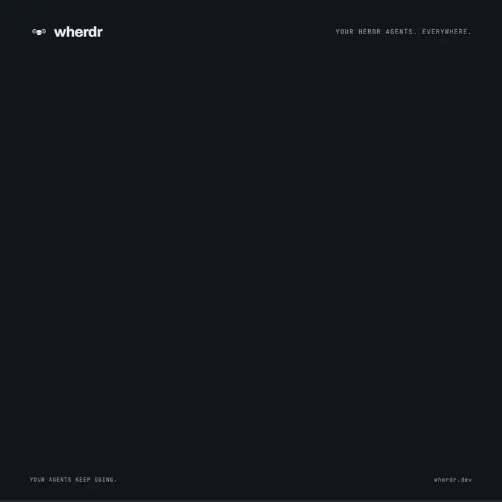

# Overview and architecture

[Documentation](README.md) · [Project](../README.md)

<p align="center">
  
</p>

<h1 align="center">wherdr</h1>

<p align="center"><b>Start your <a href="https://herdr.dev">Herdr</a> agents on your computer.
Follow their work and answer from your phone.</b></p>

<p align="center">Add it to your home screen like an app — no App Store needed.</p>

<p align="center">
  <a href="../assets/wherdr-launch.mp4"></a>
</p>
<p align="center"><sub>Start on PC. Stay in control from your phone. Real app, demo data. <a href="../assets/wherdr-launch.mp4">Watch the 15-second video</a>.</sub></p>

<p align="center"><a href="https://wherdr.dev"><b>wherdr.dev</b></a> · <a href="quick-start.md#ask-your-ai-agent">Ask your AI agent</a></p>

<p align="center"><a href="https://wherdr.dev/demo/"><b>Try it in your browser — no install</b></a>: the real app on scripted agents, nothing runs.</p>

<p align="center"><a href="https://github.com/afloury/wherdr/actions/workflows/ci.yml"></a></p>

## Why wherdr

- **Herdr's splits, live.** A tab with several panes is drawn in Herdr's real layout, every pane
  live; drag a pane to move it or a divider to resize, and the change goes to Herdr itself.
- **Private by default, passkey lock optional.** wherdr answers only its own computer and your
  tailnet. Add a passkey if you like: Face ID, Touch ID, Windows Hello or Android unlock the app,
  and nothing about your agents is served to a locked session.
- **The agent's diff.** Git status and diff of each agent's working folder, one click away from
  its conversation.
- **The herdr-projects board.** Every machine's herdr-projects tasks in the board's own groups,
  with replies to their agents, approval of finished work and a box for the Coordinator.
- **Keyboard and global search.** One shortcut searches every agent and conversation; next
  agent, new tab, pane swaps and `1`–`9` answers never need the mouse.
- **Real time, and private.** The real terminal over a WebSocket, a push when an agent needs
  you, and your phone through Tailscale: nothing is on the Internet.

Details in [Features](home.md#features) and [Security](security.md#security).

## How it works

```
phone / laptop ──private network──> HTTPS (tailscale serve, private proxy)
                                        │
                                        ▼
                             wherdr (Nitro server, 127.0.0.1:7683)
                               ├─ Herdr API socket     ~/.config/herdr/herdr.sock
                               ├─ Herdr client socket  (notifications, passive client)
                               ├─ herdr terminal session control <pane>   (terminal view)
                               ├─ transcripts          ~/.claude, ~/.codex, ~/.omp (read only)
                               └─ ssh -M <machine>     (other machines, optional)
```

wherdr runs on the same machine as the Herdr server (the "server" in these guides). It uses Herdr's local
socket API and CLI, reads the agents' transcript files, and serves a client-only Nuxt app. Data
it keeps (VAPID keys, push subscriptions, passkeys, recent folders) lives in `data/`. So do the
long texts pasted into the message field, which the server keeps to show them as cards on every
device: `data/pastes.json`, in clear, readable by the server's user only (mode 600), at most the
last 100 texts and 2 MB, each one deleted 30 days after it was last sent.

Built with Nuxt 4, Nuxt UI 4, Tailwind 4 and TypeScript; the Herdr gateway (API, WebSockets,
Web Push, lock) runs in Nitro.

## License

[MIT](../LICENSE). The embedded font subsets keep their own licenses (`app/assets/fonts/`).
