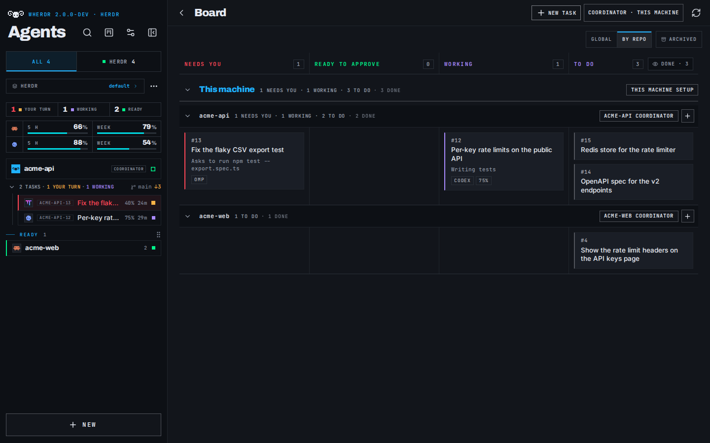

# First launch

[Documentation](README.md) · [Project](../README.md)

## Quick start

### Ask your AI agent

**Recommended.** Paste this into Claude Code, Codex or any coding agent: it installs and sets up wherdr for you.

```text
Read https://wherdr.dev/agent.md and help me set up wherdr. Check what is already installed first, and ask me before installing anything.
```

It follows [our setup guide for agents](https://wherdr.dev/agent.md): checks what you already have,
asks before installing anything, sets up your phone over Tailscale, never exposes wherdr to the Internet.

### Or run the installer yourself

On the computer that runs [Herdr](https://herdr.dev) (≥ 0.9.1), macOS or Linux:

```sh
curl -fsSL https://wherdr.dev/install | sh
```

It installs the wherdr [Herdr plugin](plugins.md#install-as-a-herdr-plugin) with the verified package of the
GitHub release, runs wherdr natively as your user on `http://localhost:7683`, starts it at every
boot (a `systemd --user` service with lingering on Linux, a LaunchAgent on macOS) and opens its
setup guide in your browser; then **prefix+i** in Herdr opens the wherdr panel. Without Herdr, it
says where to get it; without Node.js 22, it offers to install it (Homebrew, or the official
build in `~/wherdr/node`, no sudo). On a server without a screen (or over SSH), it prints the
address and the phone steps instead. See [The one command](installation.md#the-one-command).

**wherdr 2.0 runs only natively**, as your user, so it can act on the
[herdr-projects Board](board.md#works-great-with-herdr-projects) (Coordinator, reply, start, stop,
approve). Other ways, after it: `herdr plugin install afloury/wherdr` (the same plugin, without
the checks), and [the `wherdr` command](command.md#the-wherdr-command) from npm or Homebrew (npm can hold a
new release for up to two days; the installer gets it from GitHub at once).

At first launch, wherdr opens a **setup guide**: the Herdr agents it found, your phone
(Tailscale), then the passkey lock and notifications. Skip it any time; finishing or skipping is
saved on the server (`data/onboarding.json`), so your other devices do not show it again. Reopen
it from Settings › About › **Setup guide**. On a phone that already opens wherdr through its
tailnet address, the phone step becomes Add to Home Screen.

**Passkeys are tied to the address they are created on.** Once wherdr's tailnet address is
published and answers, the guide opened on `localhost` shows **Continue on
<machine>.<tailnet>.ts.net**, which reopens it at the same step on that address, and its Security
step (like Settings › Security) sends the passkey lock there. Nothing redirects on its own:
`localhost` stays valid on the computer. The installer, the Herdr plugin and `wherdr open` open
that address too when it is already published.

wherdr is a small self-hosted web app that talks to the Herdr server on your machine. **On a
computer**, it can replace the Herdr terminal client day to day: your spaces, tabs and split panes
side by side, live conversations and real terminals, drag-and-drop layout, keyboard shortcuts
and a task board for herdr-projects. **On a phone**, installed as a PWA, it is the companion
that follows your agents when you are away: push notifications when an agent finishes or needs
you, one-tap answers, quick replies and offline reading.

It lists your agents live — Claude Code, Codex and the other agents Herdr recognizes — and works
on the same Herdr session `herdr` attaches to: nothing is copied, nothing runs in the cloud. Use
it on `localhost`, or from your other devices over Tailscale.

> [!WARNING]
> **wherdr is a remote shell on your machine.** Anyone who can reach it can start agents and
> run commands as your user. **Never expose it on the public Internet** (no port forwarding, no
> public reverse proxy, no tunnel). Use it on `localhost`, or from your other devices through a
> private network such as [Tailscale](https://tailscale.com). wherdr refuses any other network
> by itself; the passkey lock is an optional extra. See [Security](security.md#security).

<p align="center">
  
</p>
<p align="center"><sub>On a computer</sub></p>
<br>
<p align="center">
  
</p>
<p align="center"><sub>The Board: every task of every project, with <a href="board.md#works-great-with-herdr-projects">herdr-projects</a></sub></p>
<br>
<p align="center">
  
  &nbsp;&nbsp;&nbsp;&nbsp;
  
</p>
<p align="center"><sub>On a phone: the same agents, the same session.</sub></p>

*Unofficial project. Not affiliated with or endorsed by Herdr, Anthropic or OpenAI. Claude,
Claude Code, Codex and other product names are trademarks of their respective owners.*
