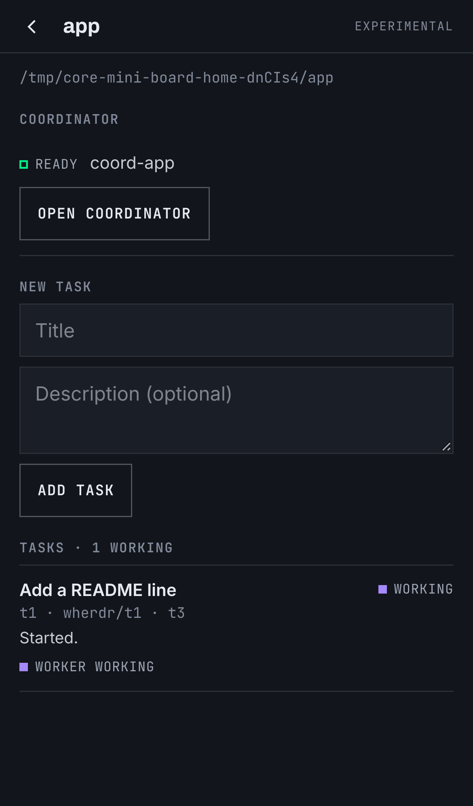
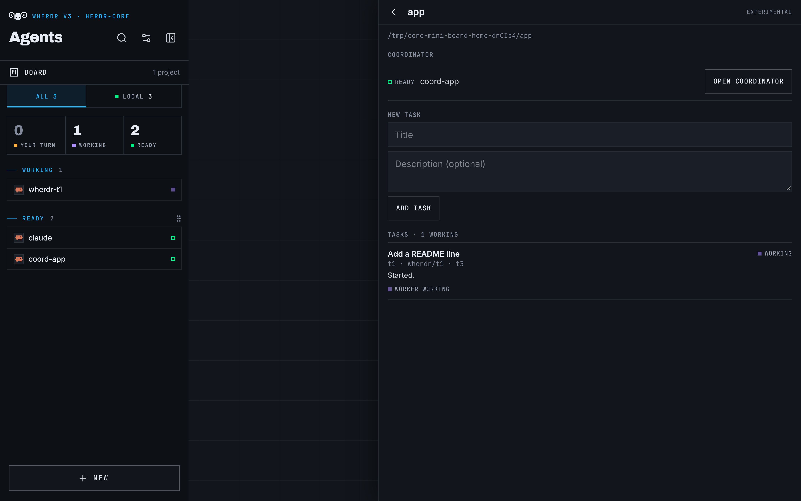

# mini-board (experimental)

> [!WARNING]
> **Experimental prototype, herdr-core (v3) only.** The format of `.wherdr/tasks.json` and the
> coordinator's instructions may change. It starts real Claude Code agents that edit your
> repository (in worktrees, on their own branches); it never merges or pushes.

A tiny herdr-projects as a [wherdr plugin](../../../docs/plugins.md). Per project folder:

- a **task list** in `<project>/.wherdr/tasks.json`;
- a **coordinator**: a real Claude Code agent in herdr-core, started in the project folder with
  [`src/coordinator.md`](src/coordinator.md) as its first message. It keeps the task list, creates a
  git worktree and branch per task (`.wherdr/worktrees/<id>`, `wherdr/<id>`), starts a worker
  with `hc run --bg claude "<task>"` there (labels `wherdr.task`, `wherdr.project`, `herdr.space`),
  follows the workers with `hc wait` / `hc read`, answers or escalates, and marks tasks `review`,
  `done` or `failed` with a short note. At most `maxWorkers` workers at once (default 2). **It never
  merges: you do.**

The plugin itself is only the Board: a **Board** row on the home opens a panel with the project
folders (where your agents run, plus folders you add), and for each one the task list (from the
file, with each worker's live state from its `wherdr.task` label), **Add task** (written to the
file), **Start coordinator** / **Open coordinator**, and a tap on a task opens its worker.

| Phone (390 px) | Desktop |
|---|---|
|  |  |

(From the fake-core e2e, `tests/e2e/core-mini-board.spec.ts`.)

## Files

- `manifest.json`, `index.js`: what you install (`index.js` is prebuilt, no imports).
- `src/index.ts` (the Board), `src/tasks.ts` (the tasks.json parser), `src/coordinator.md` (the
  coordinator's instructions) and `src/coordinator.ts`. Rebuild with `npm run build:mini-board`
  from the repo root.

## Install

1. wherdr v3 (`WHERDR_BACKEND=core`), with `claude` installed on the machine, and a project that is
   a Git repository under your home folder.
2. Copy the two files:
   ```sh
   mkdir -p data/plugins/mini-board
   cp examples/plugins/mini-board/{manifest.json,index.js} data/plugins/mini-board/
   ```
   (`data/` is wherdr's `DATA_DIR`.) Reload the page: Settings › Plugins lists **Mini-board**.
3. On the home, tap **Board**, pick the project (or add its folder), add a task, then
   **Start coordinator**. The coordinator's conversation opens; Claude Code may first ask you to
   trust the folder.

**Remove:** delete `data/plugins/mini-board` and reload. wherdr is unchanged. The tasks file,
the worktrees and the branches stay in the project: remove them with `git worktree remove` and
`git branch -D` once merged, and `rm -r .wherdr`.

## tasks.json

```json
{ "version": 1, "maxWorkers": 2, "tasks": [
  { "id": "t1", "title": "Add a README line", "description": "", "status": "todo",
    "terminal": null, "branch": null, "notes": "" }
] }
```

`status`: `todo`, `working`, `review` (the work waits for you), `done`, `failed`. `terminal` is the
worker's hc terminal, `branch` its branch, `notes` the coordinator's short note ("Needs you: …"
when a worker waits on a question only you can answer). The Board reads the file every few
seconds and before each write, and never writes over a file it cannot parse.

## Limits (prototype)

- The Board and the coordinator both write the file: each reads it just before writing, but two
  writes in the same instant can still lose one. Add tasks while the coordinator waits.
- A coordinator that finished stops: open it and say "check the tasks" after adding more.
- Workers are Claude Code only; permission prompts in a worker wait for you (open it from the Board).
